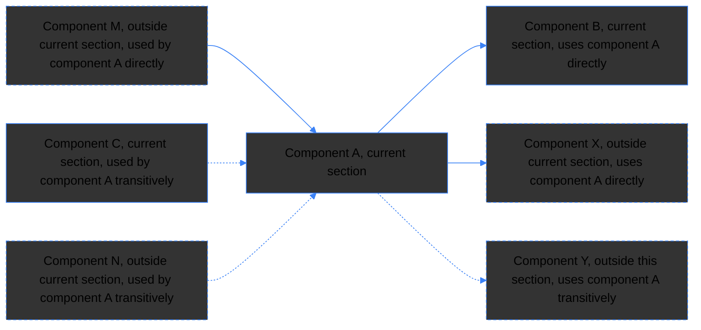
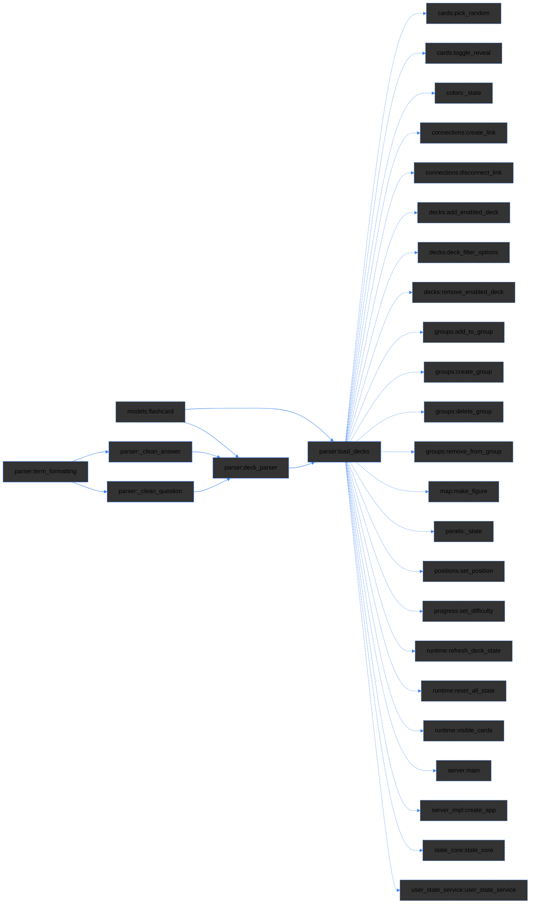
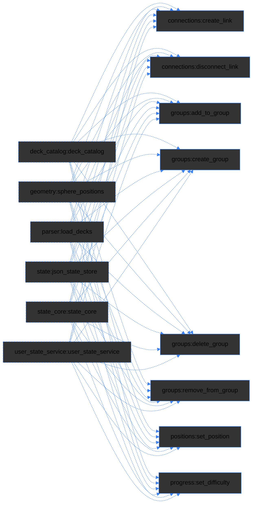
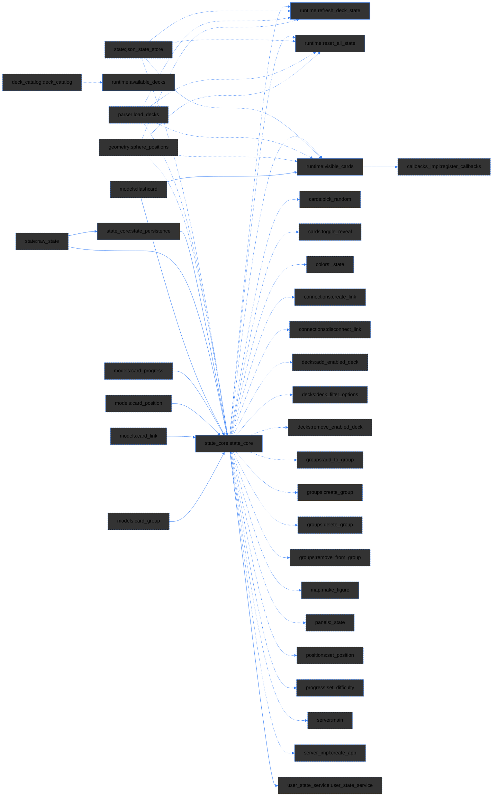
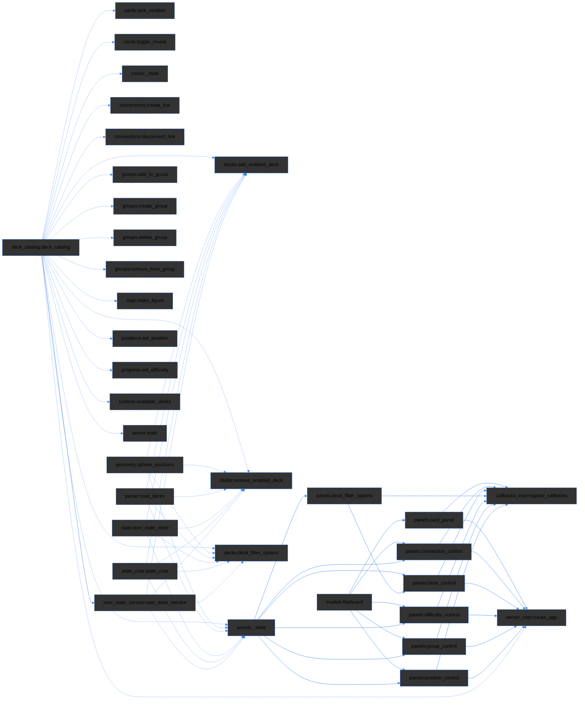
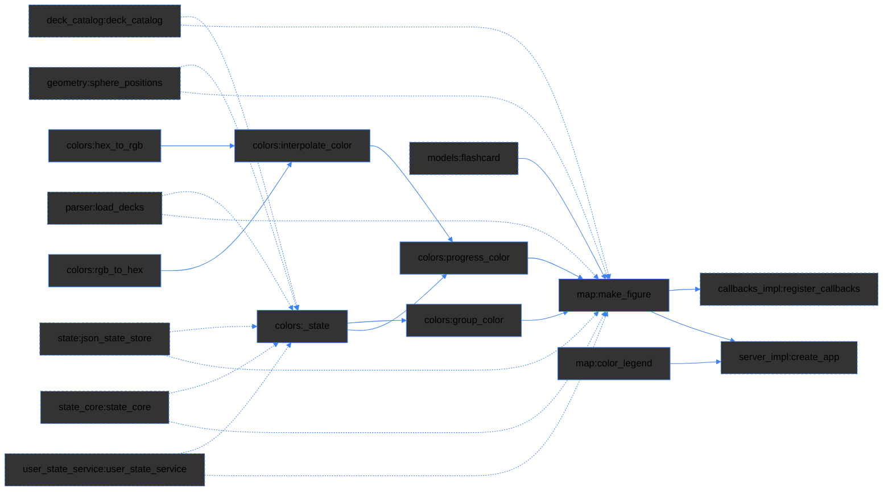
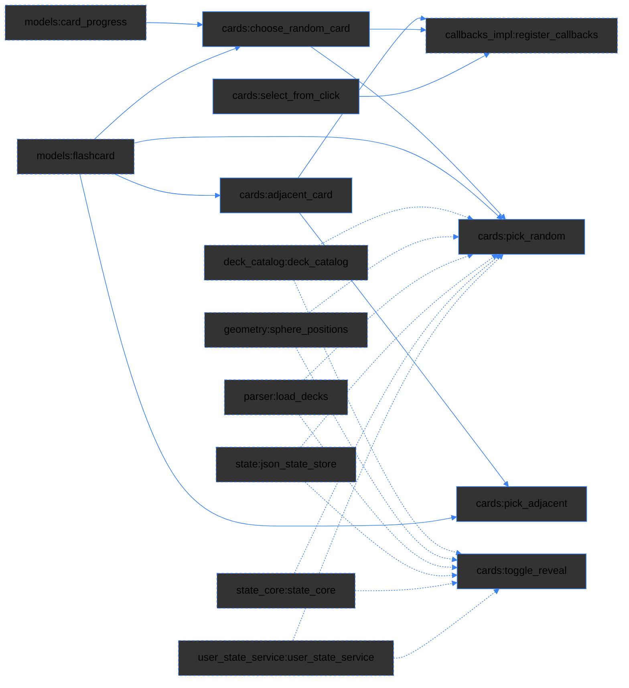
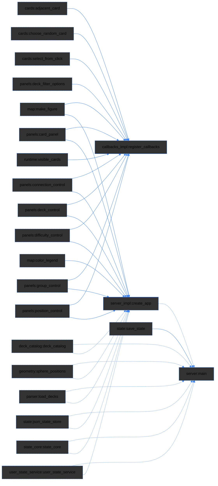

# Index Application
This file is a part of a scripted index application. Some sections of this file are generated automatically by the `update_index.py` script. Keep this in mind when editing.


## Overview

<Details markdown="1">
<Summary><font color= #3b82f6>Quick start</font></Summary>

### [Links representing components also directly select referenced code](#L91-92 "The  line numbers and the component_id in the headers are also used by the script to locate sections in the `agent_index.yaml` file, so do not modify them manually.")

The arrow next to the link reveals the details about the component. The description is provided by the user.

```yaml
tags: [your, cross, reference]
```

The indexing script `update_index.py` scans the project files, updates this index file and creates a corresponding `agent_index.yaml` file, which contains only structured metadata for AI agents.  The `tags` will be passed to the YAML file.

To run the script:

```bash
python update_index.py
```

The script also generates mermaid diagrams inside this index file based on the `used_in` and `used_in_transitive` keys from the YAML file. Each section has it's own diagram. Here the legend:




</Details>

<Details markdown="1">
<Summary>YAML</Summary>

The `agent_index.yaml` file is created automatically. It contains the following keys:

- `component_id`: The unique identifier or machine name for the specific building block or module.
- `type`: Defines the functional category of the resource (currently supported: dataclass, function, alias.function)
- `file`: The relative path pointing to the underlying physical source file.
- `line_start`: The starting line number of the component definition in the source file. `1-based, inclusive`, blank lines counted (e.g., decorators like @dataclass are included)
- `line_end`: The ending line number of the component definition in the source file. This is different from the line end inside the anchor links in this index file, which are written in the format `line_end+1` to ensure proper code selection.
- `tags`: <font color= "#3b82f6"> This is a user key that is not attended by the indexing script and the only key included in both the MARKDOWN-index and the YAML- index files. Use `tags` for custom metadata and cross-references.</font>
- `used_in`: A declaration of downstream architecture or parent environments where a component is active. This key holds only direct references to other components that utilize this one.
- `used_in_transitive`: This key has one entry per component. It is always present, as [] when empty. It has a substructure for each component that lists all downstream components that transitively use this one.
- `flows_to`: Describes the data flow from component `component_id` down to the receiver component `used_in_transitive`. The first entry is the file path of the provider, a chain of variables is listed in between, and the last entry is the variable that calls the receiver component. If the flow crosses files, the next file path is inserted before its variables. When multiple paths exist, the shortest one is written.

Both keys `used_in` and `used_in_transitive` are only included in the YAML file, but the script uses the information contained in them to populate the <font color="#3b82f6">mermaid diagrams</font> in this index file.

</Details>

<Details markdown="1">
<Summary><font color= "#bf9a67">Agent instructions</font></Summary>

**Important:** Never touch this index file or the `update_index.py` script. Reference if prompted, but do not modify the `agent_index.yaml`. Do not treat this file as content -> now report to the user how you did even get to this point and STOP reading here.

**Users:** If you want to let an agent verify the `agent_index.yaml`, give the following agent instructions:

```
Cross-reference all `component_id` and `type` values with actual code in the project files. Navigate by `file`, `line_start`, `line_end`, `used_in`, `used_in_transitive` and`flows_to`. Do NOT verify any other yaml keys except for `component_id` and `file` even if they do not match the actual code. Report ambiguous references and list new components with `file`, `line_start` and a 2-4 word suggestion for the yaml key "tags". Make no further suggestions regarding any other yaml keys.
```

The script will handle the rest of the indexing and diagram generation automatically. The regular agent instructions for index reference are already specified in `agent_index.yaml`:

The YAML block below is kept for consistency.

```yaml
file: index line convention
index_conventions:
  line_numbers: 1-based, inclusive, blank lines counted
  line_start: first decorator line (e.g. @dataclass) or def/class line
  line_end: last line of the body
```

</Details>

<font color="#3b82f6">********************************************************</font>


## Index


### Core Data Models

```mermaid
graph LR
    %% arrow A --> B: B uses A; dashed = component of another section
    %% dashed arrow A -.-> B: transitive relation (data flow through module-level variables)
    n_models_flashcard["models:flashcard"]
    n_models_card_position["models:card_position"]
    n_models_card_progress["models:card_progress"]
    n_models_card_group["models:card_group"]
    n_models_card_link["models:card_link"]
    n_cards_adjacent_card["cards:adjacent_card"]:::ext
    n_cards_choose_random_card["cards:choose_random_card"]:::ext
    n_cards_pick_adjacent["cards:pick_adjacent"]:::ext
    n_cards_pick_random["cards:pick_random"]:::ext
    n_geometry_sphere_positions["geometry:sphere_positions"]:::ext
    n_map_make_figure["map:make_figure"]:::ext
    n_panels_card_panel["panels:card_panel"]:::ext
    n_panels_connection_control["panels:connection_control"]:::ext
    n_panels_difficulty_control["panels:difficulty_control"]:::ext
    n_panels_group_control["panels:group_control"]:::ext
    n_panels_position_control["panels:position_control"]:::ext
    n_parser_deck_parser["parser:deck_parser"]:::ext
    n_parser_load_decks["parser:load_decks"]:::ext
    n_runtime_visible_cards["runtime:visible_cards"]:::ext
    n_state_load_groups["state:load_groups"]:::ext
    n_state_load_links["state:load_links"]:::ext
    n_state_load_positions["state:load_positions"]:::ext
    n_state_load_progress["state:load_progress"]:::ext
    n_state_raw_state["state:raw_state"]:::ext
    n_state_read_state_file["state:read_state_file"]:::ext
    n_state_save_state["state:save_state"]:::ext
    n_state_core_state_core["state_core:state_core"]:::ext
    n_user_state_service_user_state_service["user_state_service:user_state_service"]:::ext
    n_models_card_group --> n_state_load_groups
    n_models_card_group --> n_state_raw_state
    n_models_card_group --> n_state_read_state_file
    n_models_card_group --> n_state_save_state
    n_models_card_group --> n_state_core_state_core
    n_models_card_group --> n_user_state_service_user_state_service
    n_models_card_link --> n_state_load_links
    n_models_card_link --> n_state_raw_state
    n_models_card_link --> n_state_read_state_file
    n_models_card_link --> n_state_save_state
    n_models_card_link --> n_state_core_state_core
    n_models_card_link --> n_user_state_service_user_state_service
    n_models_card_position --> n_geometry_sphere_positions
    n_models_card_position --> n_state_load_positions
    n_models_card_position --> n_state_raw_state
    n_models_card_position --> n_state_read_state_file
    n_models_card_position --> n_state_save_state
    n_models_card_position --> n_state_core_state_core
    n_models_card_position --> n_user_state_service_user_state_service
    n_models_card_progress --> n_cards_choose_random_card
    n_models_card_progress --> n_state_load_progress
    n_models_card_progress --> n_state_raw_state
    n_models_card_progress --> n_state_read_state_file
    n_models_card_progress --> n_state_save_state
    n_models_card_progress --> n_state_core_state_core
    n_models_card_progress --> n_user_state_service_user_state_service
    n_models_flashcard --> n_cards_adjacent_card
    n_models_flashcard --> n_cards_choose_random_card
    n_models_flashcard --> n_cards_pick_adjacent
    n_models_flashcard --> n_cards_pick_random
    n_models_flashcard --> n_map_make_figure
    n_models_flashcard --> n_panels_card_panel
    n_models_flashcard --> n_panels_connection_control
    n_models_flashcard --> n_panels_difficulty_control
    n_models_flashcard --> n_panels_group_control
    n_models_flashcard --> n_panels_position_control
    n_models_flashcard --> n_parser_deck_parser
    n_models_flashcard --> n_parser_load_decks
    n_models_flashcard --> n_runtime_visible_cards
    n_models_flashcard --> n_state_core_state_core
    n_models_flashcard --> n_user_state_service_user_state_service
    classDef ext stroke:#3b82f6,stroke-dasharray: 4 3
    linkStyle default stroke: #3b82f6, color: #3b82f6
    classDef default fill:inherit, stroke: #3b82f6, color:inherit;
```

<!-- diagram:start (generated by update_index.py - do not edit) -->

<!-- diagram:end -->

The core data models define the primary entities used throughout the flashcards application, including flashcards, card positions, and card progress.


<details><Summary><a href="./flashcards_app/models.py#L4-10" title="models:flashcard">Test</a></Summary>

```yaml
tags: [Test]
```
</Details>


<Details>

<Summary><sd

#### [Flashcard](./flashcards_app/models.py#L4-10 "models:flashcard")</Summary>


```yaml
tags: [card, entity, core]
```

</Details>


<Details markdown="1">
<Summary><sd

#### [Card position](./flashcards_app/models.py#L11-19 "models:card_position")

</Summary>


```yaml
tags: [position, geometry, 3d]
```

</Details>


<Details markdown="1">
<Summary><sd

#### [Card progress](./flashcards_app/models.py#L20-27 "models:card_progress")

</Summary>


```yaml
tags: [tracking, progress, learning, difficulty]
```

</Details>


<Details markdown="1">
<Summary><sd

#### [Card group](./flashcards_app/models.py#L28-35 "models:card_group")

</Summary>


```yaml
tags: [group, organizer, color]
```

</Details>


<Details markdown="1">
<Summary><sd

#### [Card link](./flashcards_app/models.py#L36-40 "models:card_link")

</Summary>


```yaml
tags: [connection, link, relationship]
```

</Details>


<font color="#3b82f6">********************************************************</font>

### Content ingestion

<!-- diagram:start (generated by update_index.py - do not edit) -->

<!-- diagram:end -->

The content ingestion system is responsible for extracting structured data from markdown deck files. It identifies specified blocks and converts them into objects.

<Details markdown="1">
<Summary><sd

#### [Parse deck](./flashcards_app/parser.py#L47-80 "parser:deck_parser")

</Summary>


```yaml
tags: [parsing, markdown, deck]
```

</Details>


<Details markdown="1">
<Summary><sd

#### [Clean question](./flashcards_app/parser.py#L31-40 "parser:_clean_question")

</Summary>


```yaml
tags: []
```

</Details>


<Details markdown="1">
<Summary><sd

#### [Clean answer](./flashcards_app/parser.py#L41-46 "parser:_clean_answer")

</Summary>

```yaml
tags: []
```

</Details>


<Details markdown="1">
<Summary><sd

#### [Format technical terms](./flashcards_app/parser.py#L23-30 "parser:term_formatting")

</Summary>

```yaml
tags: [formatting, technical_terms, markdown]
```

</Details>


<Details markdown="1">
<Summary><sd

#### [Load decks](./flashcards_app/parser.py#L81-96 "parser:load_decks")

</Summary>


```yaml
tags: [loading, deck, filtering]
```

</Details>


<font color="#3b82f6">********************************************************</font>


### State persistence

```mermaid
graph LR
    %% arrow A --> B: B uses A; dashed = component of another section
    %% dashed arrow A -.-> B: transitive relation (data flow through module-level variables)
    n_state_load_enabled_decks["state:load_enabled_decks"]
    n_state_load_positions["state:load_positions"]
    n_state_load_progress["state:load_progress"]
    n_state_load_groups["state:load_groups"]
    n_state_load_links["state:load_links"]
    n_state_save_state["state:save_state"]
    n_state_read_state_file["state:read_state_file"]
    n_state_write_state_file["state:write_state_file"]
    n_state_json_state_store["state:json_state_store"]
    n_user_state_service_user_state_service["user_state_service:user_state_service"]
    n_state_state_file_error["state:state_file_error"]
    n_state_raw_state["state:raw_state"]
    n_geometry_sphere_positions["geometry:sphere_positions"]
    n_cards_pick_random["cards:pick_random"]:::ext
    n_cards_toggle_reveal["cards:toggle_reveal"]:::ext
    n_colors__state["colors:_state"]:::ext
    n_connections_create_link["connections:create_link"]:::ext
    n_connections_disconnect_link["connections:disconnect_link"]:::ext
    n_deck_catalog_deck_catalog["deck_catalog:deck_catalog"]:::ext
    n_decks_add_enabled_deck["decks:add_enabled_deck"]:::ext
    n_decks_deck_filter_options["decks:deck_filter_options"]:::ext
    n_decks_remove_enabled_deck["decks:remove_enabled_deck"]:::ext
    n_groups_add_to_group["groups:add_to_group"]:::ext
    n_groups_create_group["groups:create_group"]:::ext
    n_groups_delete_group["groups:delete_group"]:::ext
    n_groups_remove_from_group["groups:remove_from_group"]:::ext
    n_map_make_figure["map:make_figure"]:::ext
    n_models_card_group["models:card_group"]:::ext
    n_models_card_link["models:card_link"]:::ext
    n_models_card_position["models:card_position"]:::ext
    n_models_card_progress["models:card_progress"]:::ext
    n_models_flashcard["models:flashcard"]:::ext
    n_panels__state["panels:_state"]:::ext
    n_parser_load_decks["parser:load_decks"]:::ext
    n_positions_set_position["positions:set_position"]:::ext
    n_progress_set_difficulty["progress:set_difficulty"]:::ext
    n_runtime_refresh_deck_state["runtime:refresh_deck_state"]:::ext
    n_runtime_reset_all_state["runtime:reset_all_state"]:::ext
    n_runtime_visible_cards["runtime:visible_cards"]:::ext
    n_server_main["server:main"]:::ext
    n_server_impl_create_app["server_impl:create_app"]:::ext
    n_state_core_state_core["state_core:state_core"]:::ext
    n_state_core_state_persistence["state_core:state_persistence"]:::ext
    n_deck_catalog_deck_catalog --> n_user_state_service_user_state_service
    n_geometry_sphere_positions --> n_state_load_positions
    n_models_card_group --> n_state_load_groups
    n_models_card_group --> n_state_raw_state
    n_models_card_group --> n_state_read_state_file
    n_models_card_group --> n_state_save_state
    n_models_card_group --> n_user_state_service_user_state_service
    n_models_card_link --> n_state_load_links
    n_models_card_link --> n_state_raw_state
    n_models_card_link --> n_state_read_state_file
    n_models_card_link --> n_state_save_state
    n_models_card_link --> n_user_state_service_user_state_service
    n_models_card_position --> n_geometry_sphere_positions
    n_models_card_position --> n_state_load_positions
    n_models_card_position --> n_state_raw_state
    n_models_card_position --> n_state_read_state_file
    n_models_card_position --> n_state_save_state
    n_models_card_position --> n_user_state_service_user_state_service
    n_models_card_progress --> n_state_load_progress
    n_models_card_progress --> n_state_raw_state
    n_models_card_progress --> n_state_read_state_file
    n_models_card_progress --> n_state_save_state
    n_models_card_progress --> n_user_state_service_user_state_service
    n_models_flashcard --> n_user_state_service_user_state_service
    n_state_raw_state --> n_state_json_state_store
    n_state_raw_state --> n_state_read_state_file
    n_state_raw_state --> n_state_save_state
    n_state_raw_state --> n_state_write_state_file
    n_state_raw_state --> n_state_core_state_core
    n_state_raw_state --> n_state_core_state_persistence
    n_state_read_state_file --> n_state_json_state_store
    n_state_save_state --> n_server_main
    n_state_state_file_error --> n_state_read_state_file
    n_state_write_state_file --> n_state_json_state_store
    n_state_write_state_file --> n_state_save_state
    n_state_core_state_core --> n_user_state_service_user_state_service
    n_geometry_sphere_positions -.-> n_cards_pick_random
    n_geometry_sphere_positions -.-> n_cards_toggle_reveal
    n_geometry_sphere_positions -.-> n_colors__state
    n_geometry_sphere_positions -.-> n_connections_create_link
    n_geometry_sphere_positions -.-> n_connections_disconnect_link
    n_geometry_sphere_positions -.-> n_decks_add_enabled_deck
    n_geometry_sphere_positions -.-> n_decks_deck_filter_options
    n_geometry_sphere_positions -.-> n_decks_remove_enabled_deck
    n_geometry_sphere_positions -.-> n_groups_add_to_group
    n_geometry_sphere_positions -.-> n_groups_create_group
    n_geometry_sphere_positions -.-> n_groups_delete_group
    n_geometry_sphere_positions -.-> n_groups_remove_from_group
    n_geometry_sphere_positions -.-> n_map_make_figure
    n_geometry_sphere_positions -.-> n_panels__state
    n_geometry_sphere_positions -.-> n_positions_set_position
    n_geometry_sphere_positions -.-> n_progress_set_difficulty
    n_geometry_sphere_positions -.-> n_runtime_refresh_deck_state
    n_geometry_sphere_positions -.-> n_runtime_reset_all_state
    n_geometry_sphere_positions -.-> n_runtime_visible_cards
    n_geometry_sphere_positions -.-> n_server_main
    n_geometry_sphere_positions -.-> n_server_impl_create_app
    n_geometry_sphere_positions -.-> n_state_core_state_core
    n_geometry_sphere_positions -.-> n_user_state_service_user_state_service
    n_parser_load_decks -.-> n_user_state_service_user_state_service
    n_state_json_state_store -.-> n_cards_pick_random
    n_state_json_state_store -.-> n_cards_toggle_reveal
    n_state_json_state_store -.-> n_colors__state
    n_state_json_state_store -.-> n_connections_create_link
    n_state_json_state_store -.-> n_connections_disconnect_link
    n_state_json_state_store -.-> n_decks_add_enabled_deck
    n_state_json_state_store -.-> n_decks_deck_filter_options
    n_state_json_state_store -.-> n_decks_remove_enabled_deck
    n_state_json_state_store -.-> n_groups_add_to_group
    n_state_json_state_store -.-> n_groups_create_group
    n_state_json_state_store -.-> n_groups_delete_group
    n_state_json_state_store -.-> n_groups_remove_from_group
    n_state_json_state_store -.-> n_map_make_figure
    n_state_json_state_store -.-> n_panels__state
    n_state_json_state_store -.-> n_positions_set_position
    n_state_json_state_store -.-> n_progress_set_difficulty
    n_state_json_state_store -.-> n_runtime_refresh_deck_state
    n_state_json_state_store -.-> n_runtime_reset_all_state
    n_state_json_state_store -.-> n_runtime_visible_cards
    n_state_json_state_store -.-> n_server_main
    n_state_json_state_store -.-> n_server_impl_create_app
    n_state_json_state_store -.-> n_state_core_state_core
    n_state_json_state_store -.-> n_user_state_service_user_state_service
    n_user_state_service_user_state_service -.-> n_cards_pick_random
    n_user_state_service_user_state_service -.-> n_cards_toggle_reveal
    n_user_state_service_user_state_service -.-> n_colors__state
    n_user_state_service_user_state_service -.-> n_connections_create_link
    n_user_state_service_user_state_service -.-> n_connections_disconnect_link
    n_user_state_service_user_state_service -.-> n_decks_add_enabled_deck
    n_user_state_service_user_state_service -.-> n_decks_deck_filter_options
    n_user_state_service_user_state_service -.-> n_decks_remove_enabled_deck
    n_user_state_service_user_state_service -.-> n_groups_add_to_group
    n_user_state_service_user_state_service -.-> n_groups_create_group
    n_user_state_service_user_state_service -.-> n_groups_delete_group
    n_user_state_service_user_state_service -.-> n_groups_remove_from_group
    n_user_state_service_user_state_service -.-> n_map_make_figure
    n_user_state_service_user_state_service -.-> n_panels__state
    n_user_state_service_user_state_service -.-> n_positions_set_position
    n_user_state_service_user_state_service -.-> n_progress_set_difficulty
    n_user_state_service_user_state_service -.-> n_server_main
    n_user_state_service_user_state_service -.-> n_server_impl_create_app
    classDef ext stroke:#3b82f6,stroke-dasharray: 4 3
    linkStyle default stroke: #3b82f6, color: #3b82f6
    classDef default fill:inherit, stroke: #3b82f6, color:inherit;
```

<!-- diagram:start (generated by update_index.py - do not edit) -->

<!-- diagram:end -->

This is subject to change during the refactoring process.

All state components are persisted in [data/positions.json](./data/positions.json). The location is defined as [STATE_PATH](./flashcards_app/runtime.py#STATE_PATH).


<Details markdown="1">
<Summary><sd

#### [Load enabled decks](./flashcards_app/state.py#L86-100 "state:load_enabled_decks")

</Summary>

```yaml
tags: [loading, deck, persistence]
```

</Details>


<Details markdown="1">
<Summary><sd

#### [Load positions](./flashcards_app/state.py#L12-27 "state:load_positions")

</Summary>


```yaml
tags: [positions, geometry, persistence]
```

</Details>


<Details markdown="1">
<Summary><sd

#### [Load progress](./flashcards_app/state.py#L28-46 "state:load_progress")

</Summary>


```yaml
tags: [progress, persistence]
```

</Details>


<Details markdown="1">
<Summary><sd

#### [Load groups](./flashcards_app/state.py#L48-66 "state:load_groups")

</Summary>


```yaml
tags: [groups, persistence]
```

</Details>


<Details markdown="1">
<Summary><sd

#### [Load links](./flashcards_app/state.py#L68-84 "state:load_links")

</Summary>


```yaml
tags: [links, persistence]
```

</Details>


<Details markdown="1">
<Summary><sd

#### [Save state](./flashcards_app/state.py#L206-224 "state:save_state")

</Summary>


```yaml
tags: [persistence, state, json]
```

</Details>


### [Read state file](./flashcards_app/state.py#L126-164 "state:read_state_file")

```yaml
tags: []
```

### [Write state file](./flashcards_app/state.py#L166-190 "state:write_state_file")

```yaml
tags: []
```

### [Json state store](./flashcards_app/state.py#L192-204 "state:json_state_store")

```yaml
tags: []
```


### [User state service](./flashcards_app/user_state_service.py#L17-123 "user_state_service:user_state_service")

```yaml
tags: []
```


### [State file error](./flashcards_app/state.py#L113-115 "state:state_file_error")

```yaml
tags: []
```

### [Raw state](./flashcards_app/state.py#L117-124 "state:raw_state")

```yaml
tags: []
```


<Details markdown="1">
<Summary><sd

#### [Sphere positions](./flashcards_app/geometry.py#L7-33 "geometry:sphere_positions")

</Summary>

```yaml
tags: [geometry, 3d, random]
```

</Details>


<font color="#3b82f6">********************************************************</font>


### Domain Actions

<!-- diagram:start (generated by update_index.py - do not edit) -->

<!-- diagram:end -->


> The interactive features are planned as controls for tuning the model's behavior within the DS project. Without the model they provide a manual interface for navigating and reflecting flashcards relationships.

-- Decks --
Selecting decks allows users to choose which decks they want to enable and interact with within the flashcards application. **This is the 1st and lowest level of detalisation**.

-- Positions --
The position of a flashcard within the sphere determines its vectorization. The spatial arrangement of flashcards shows the relative importance and relationships between different cards. It allows to establish a structured understanding of how individual flashcards relate to each other within the broader context of the knowledge sphere. **This is the 2nd level of detalisation**.


-- Groups --
Grouping flashcards into collections shows the relationships between different cards and allows users to organize their study material more effectively. **Together with connections this is the 3rd and intermediate level of detalisation**.

-- Connections --
Connecting cards allows users to establish fixed relationships between different flashcards, enhancing the study experience by linking related concepts. **Together with grouping, this is the 3rd and intermediate level of detalisation**.

-- Cards --
This last section covers navigating and selecting cards, revealing answers and tracking progress. It deals with the actual inner quality of the request. **This is the 4th and highest level of detalisation**.


<Details markdown="1">
<Summary><sd

#### [Set position](./flashcards_app/services/positions.py#L4-6 "positions:set_position")

</Summary>

```yaml
tags: []
```

</Details>


<Details markdown="1">
<Summary><sd

#### [Add to group](./flashcards_app/services/groups.py#L8-10 "groups:add_to_group")

</Summary>

```yaml
tags: []
```

</Details>


<Details markdown="1">
<Summary><sd

#### [Remove from group](./flashcards_app/services/groups.py#L12-14 "groups:remove_from_group")

</Summary>

```yaml
tags: []
```

</Details>


<Details markdown="1">
<Summary><sd

#### [Delete group](./flashcards_app/services/groups.py#L16-18 "groups:delete_group")

</Summary>

```yaml
tags: []
```

</Details>


<Details markdown="1">
<Summary><sd

#### [Create group](./flashcards_app/services/groups.py#L4-6 "groups:create_group")

</Summary>

```yaml
tags: []
```

</Details>

<Details markdown="1">
<Summary><sd

#### [Disconnect link](./flashcards_app/services/connections.py#L8-10 "connections:disconnect_link")

</Summary>

```yaml
tags: []
```

</Details>


<Details markdown="1">
<Summary><sd

#### [Create link](./flashcards_app/services/connections.py#L4-6 "connections:create_link")

</Summary>

```yaml
tags: []
```

</Details>


<Details markdown="1">
<Summary><sd

#### [Set difficulty](./flashcards_app/services/progress.py#L4-6 "progress:set_difficulty")

</Summary>

```yaml
tags: []
```

</Details>


<font color="#3b82f6">********************************************************</font>


### Derived state

<!-- diagram:start (generated by update_index.py - do not edit) -->

<!-- diagram:end -->

These components select information that is computed based on the current state, such as sphere positions, decks, cards.

State core
here


### [State core](./flashcards_app/state_core.py#L46-278 "state_core:state_core")

```yaml
tags: []
```

### [State persistence](./flashcards_app/state_core.py#L31-37 "state_core:state_persistence")

```yaml
tags: []
```


<Details markdown="1">
<Summary><sd

#### [Refresh deck state](./flashcards_app/runtime.py#L57-59 "runtime:refresh_deck_state")

</Summary>

```yaml
tags: []
```

</Details>


<Details markdown="1">
<Summary><sd

#### [Reset all state](./flashcards_app/runtime.py#L68-70 "runtime:reset_all_state")

</Summary>

```yaml
tags: []
```

</Details>

<Details markdown="1">
<Summary><sd

#### [Available decks](./flashcards_app/runtime.py#L28-30 "runtime:available_decks")

</Summary>

```yaml
tags: []
```

</Details>


<Details markdown="1">
<Summary><sd

#### [Visible cards](./flashcards_app/runtime.py#L61-66 "runtime:visible_cards")

</Summary>

```yaml
tags: []
```

</Details>


<font color="#3b82f6">********************************************************</font>


### User interface (control panels)

<!-- diagram:start (generated by update_index.py - do not edit) -->

<!-- diagram:end -->

There are various control elements located within panels. Each panel corresponds to a specific user interface component that allows interaction with flashcards.


### [Deck catalog](./flashcards_app/deck_catalog.py#L11-26 "deck_catalog:deck_catalog")

```yaml
tags: []
```


<Details markdown="1">
<Summary><sd

#### [Add enabled deck](./flashcards_app/services/decks.py#L11-13 "decks:add_enabled_deck")

</Summary>

```yaml
tags: []
```

</Details>


<Details markdown="1">
<Summary><sd

#### [Remove enabled deck](./flashcards_app/services/decks.py#L15-17 "decks:remove_enabled_deck")

</Summary>

```yaml
tags: []
```

</Details>


### [Deck filter options](./flashcards_app/services/decks.py#L4-9 "decks:deck_filter_options")

```yaml
tags: []
```


<Details markdown="1">
<Summary><sd

### [Deck filter options](./flashcards_app/visualization/panels.py#L13-18 "panels:deck_filter_options")

</Summary>

```yaml
tags: []
```

</Details>


<Details markdown="1">
<Summary><sd


### [State](./flashcards_app/visualization/panels.py#L8-11 "panels:_state")

</Summary>

```yaml
tags: []
```

</Details>


<Details markdown="1">
<Summary><sd

#### [Deck control](./flashcards_app/visualization/panels.py#L169-223 "panels:deck_control")

</Summary>

```yaml
tags: []
```

</Details>


<Details markdown="1">
<Summary><sd

#### [Card panel](./flashcards_app/visualization/panels.py#L20-38 "panels:card_panel")

</Summary>

```yaml
tags: []
```

</Details>


<Details markdown="1">
<Summary><sd

#### [Difficulty control](./flashcards_app/visualization/panels.py#L40-68 "panels:difficulty_control")

</Summary>

```yaml
tags: []
```

</Details>


<Details markdown="1">
<Summary><sd

#### [Position control](./flashcards_app/visualization/panels.py#L70-101 "panels:position_control")

</Summary>

```yaml
tags: []
```

</Details>


<Details markdown="1">
<Summary><sd

#### [Group control](./flashcards_app/visualization/panels.py#L103-167 "panels:group_control")

</Summary>

```yaml
tags: []
```

</Details>


<Details markdown="1">
<Summary><sd

#### [Connection control](./flashcards_app/visualization/panels.py#L225-263 "panels:connection_control")

</Summary>

```yaml
tags: []
```

</Details>


<font color="#3b82f6">********************************************************</font>


### Rendering visual mapping

<!-- diagram:start (generated by update_index.py - do not edit) -->

<!-- diagram:end -->

The visualization on a 3D sphere provides an intuitive way to explore the spatial relationships within the deck.

Used framework: Dash (Plotly) with Flask for boot-id endpoint Visualization: Plotly 3D Scatter plots showing cards on a sphere.

<Details markdown="1">
<Summary><sd

#### [Make figure](./flashcards_app/visualization/map.py#L9-138 "map:make_figure")

</Summary>


```yaml
tags: []
```

</Details>


<Details markdown="1">
<Summary><sd

#### [Hex to rgb](./flashcards_app/visualization/colors.py#L4-7 "colors:hex_to_rgb")

</Summary>

```yaml
tags: []
```

</Details>


<Details markdown="1">
<Summary><sd

#### [Rgb to hex](./flashcards_app/visualization/colors.py#L9-11 "colors:rgb_to_hex")

</Summary>


```yaml
tags: []
```

</Details>


<Details markdown="1">
<Summary><sd

#### [Interpolate color](./flashcards_app/visualization/colors.py#L13-22 "colors:interpolate_color")

</Summary>


```yaml
tags: []
```

</Details>


<Details markdown="1">
<Summary><sd

#### [Progress color](./flashcards_app/visualization/colors.py#L29-43 "colors:progress_color")

</Summary>

```yaml
tags: []
```

</Details>


<Details markdown="1">
<Summary><sd

#### [Group color](./flashcards_app/visualization/colors.py#L45-48 "colors:group_color")

</Summary>

```yaml
tags: []
```

</Details>


### [State](./flashcards_app/visualization/colors.py#L24-27 "colors:_state")

```yaml
tags: []
```


### [Color legend](./flashcards_app/visualization/map.py#L140-151 "map:color_legend")

```yaml
tags: []
```


<font color="#3b82f6">********************************************************</font>


### Selection logic

<!-- diagram:start (generated by update_index.py - do not edit) -->

<!-- diagram:end -->

<Details markdown="1">
<Summary><sd

#### [Choose random card](./flashcards_app/services/cards.py#L5-13 "cards:choose_random_card")

</Summary>

```yaml
tags: []
```

</Details>


<Details markdown="1">
<Summary><sd

#### [Pick random](./flashcards_app/services/cards.py#L37-40 "cards:pick_random")

</Summary>

```yaml
tags: []
```

</Details>


<Details markdown="1">
<Summary><sd

#### [Adjacent card](./flashcards_app/services/cards.py#L15-22 "cards:adjacent_card")

</Summary>

```yaml
tags: []
```

</Details>


<Details markdown="1">
<Summary><sd

#### [Pick adjacent](./flashcards_app/services/cards.py#L42-45 "cards:pick_adjacent")

</Summary>

```yaml
tags: []
```

</Details>


<Details markdown="1">
<Summary><sd

#### [Select from click](./flashcards_app/services/cards.py#L24-28 "cards:select_from_click")

</Summary>

```yaml
tags: []
```

</Details>


<Details markdown="1">
<Summary><sd

#### [Toggle reveal](./flashcards_app/services/cards.py#L30-35 "cards:toggle_reveal")

</Summary>

```yaml
tags: []
```

</Details>

<font color="#3b82f6">********************************************************</font>


### Orchestration

<!-- diagram:start (generated by update_index.py - do not edit) -->

<!-- diagram:end -->

These background functionalities manage the overall state and visibility of decks and cards within the application. Functions are moved to this section if they primarily deal with maintaining or updating the application's state rather than direct user interactions.


<Details markdown="1">
<Summary><sd

#### [Main](./flashcards_app/server.py#L8-11 "server:main")

</Summary>

```yaml
tags: []
```

</Details>


### [Register callbacks](./flashcards_app/callbacks_impl.py#L11-240 "callbacks_impl:register_callbacks")

```yaml
tags: []
```

### [Create app](./flashcards_app/server_impl.py#L11-100 "server_impl:create_app")

```yaml
tags: []
```


<font color="#3b82f6">********************************************************</font>


## Unindexed Components

<font color="green">If you see any components below, note that the keys are proposals. Copy the components manually into the appropriate section above and complete the metadata.

Once you placed the new components into the appropriate sections above, run the `update_index.py` script again to regenerate the index. The section below is regenerated on each run, from its title line to the end of the file. Don't add your own text or tags below it. They would be overwritten. </font>

**End of file**
