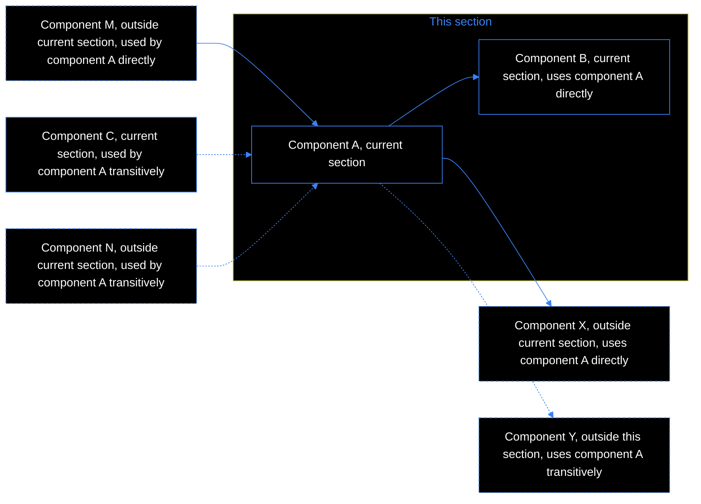
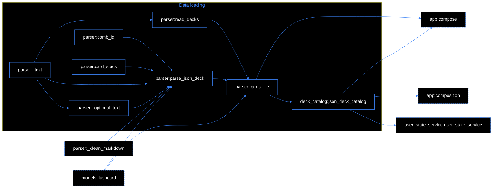
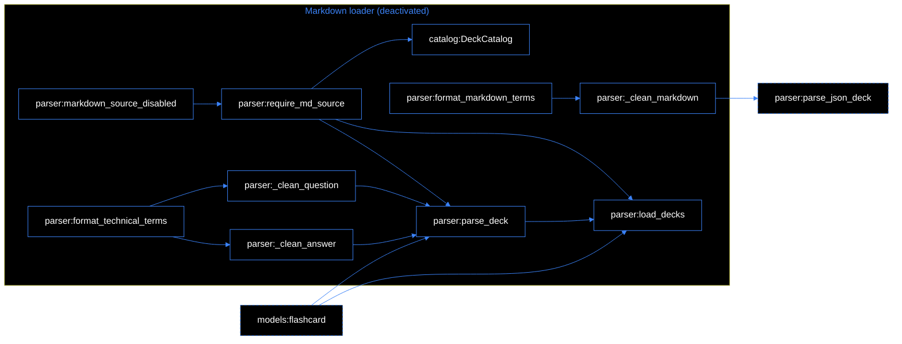
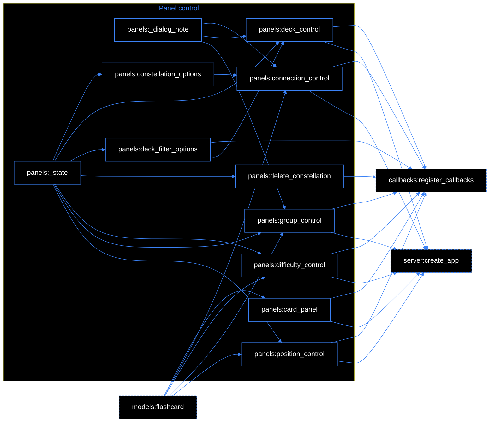
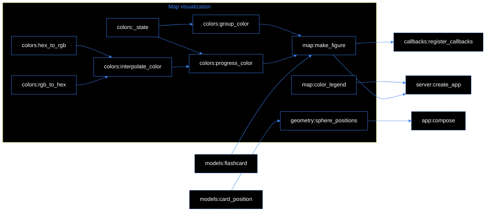
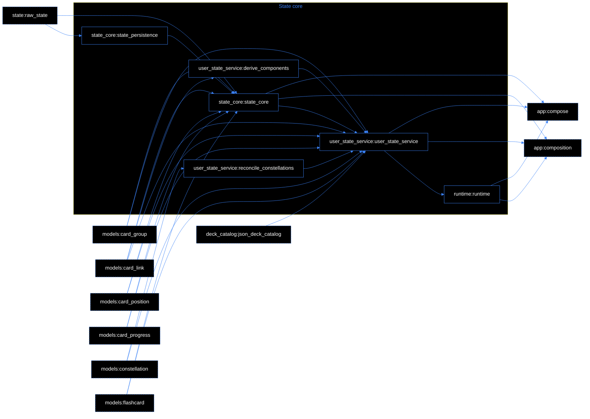
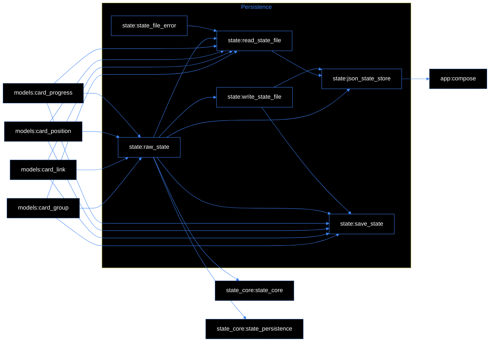
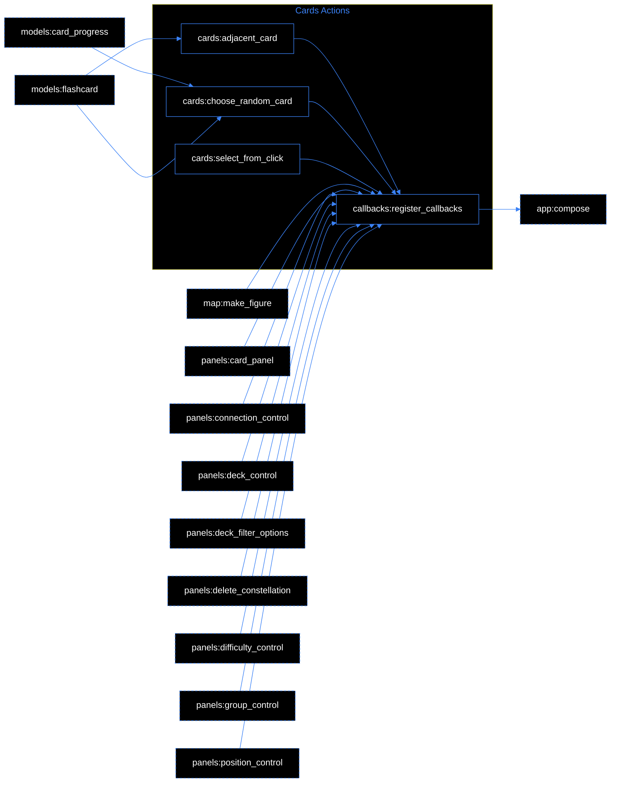
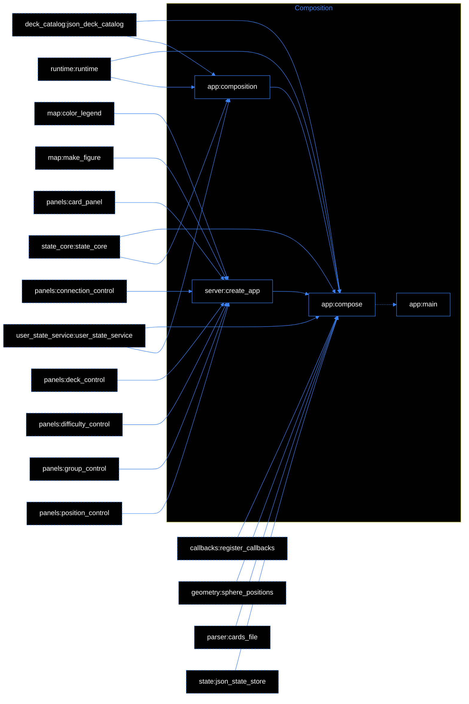

# Indexing tool
This file is a part of a scripted indexing tool.


## Overview


<details>
<Summary><a href="./readme.md#L1-5" title="path:component"><font color= #3b82f6>Navigation</font></a></Summary>

- Click on the header jumps to the code.
- Click on the arrow reveals the description.
- Sections are represented by `###`.
</Details>

<details>
<Summary><a href="#editing" title="path:component"><font color= #3b82f6>Editing</font></a></Summary>

- In the header only the name should be modified manually.
- Edit the description. The tags are for manual cross reference.
- Edit the `tags`, they will be passed to the `agent_index.yaml` file.
</Details>

<details>
<Summary><a href="#diagrams" title="path:component"><font color= #3b82f6>Diagrams</font></a></Summary>

<a id="diagrams"></a>

Each section has it's own generated diagram. Legend:

</Details>

<details>
<Summary>
<a href="./tools/update_index.py#L1" title="path:component"><font color= #3b82f6>Script</font></a></Summary>

```bash
.venv/Scripts/python.exe update_index.py
```

- Run the script `update_index.py` to scan the project files.
- The script finds allcomponents by `used_in` and `used_in_transitive` keys.
- All technical references in this index file will be automatically updated.
- New components will be automatically added at the end of this file.
- The `agent_index.yaml` file with metadata will be updated or created if it does not exist.
</Details>

<details>
<Summary><a href="./tools/agent_index.yaml#L1" title="path:component"><font color= #3b82f6>Metadata</font></a></Summary>

- The `agent_index.yaml` provides metadata for agents.
- The `line_start` is `1-based, inclusive`, blank lines counted.
- The `line_end` is different by `line_end+1` to ensure proper code selection.
</Details>


## Index

### Data loading

<!-- diagram:start (generated by update_index.py - do not edit) -->

<!-- diagram:end -->


<details><Summary><a href="./flashcards_app/parser.py#L214-246" title="parser:parse_json_deck">Parse json deck</a></Summary>

```yaml
tags: []
```
</details>

<details><Summary><a href="./flashcards_app/parser.py#L248-295" title="parser:cards_file">Cards file</a></Summary>

```yaml
tags: []
```
</details>

<details><Summary><a href="./flashcards_app/deck_catalog.py#L36-52" title="deck_catalog:json_deck_catalog">Json deck catalog</a></Summary>

```yaml
tags: []
```
</details>

<details><Summary><a href="./flashcards_app/parser.py#L169-174" title="parser:_text">Text</a></Summary>

```yaml
tags: []
```
</details>

<details><Summary><a href="./flashcards_app/parser.py#L175-177" title="parser:_optional_text">Optional text</a></Summary>

```yaml
tags: []
```
</details>

<details><Summary><a href="./flashcards_app/parser.py#L178-184" title="parser:card_stack">Card stack</a></Summary>

```yaml
tags: []
```
</details>

<details><Summary><a href="./flashcards_app/parser.py#L185-187" title="parser:comb_id">Comb id</a></Summary>

```yaml
tags: []
```
</details>

<details><Summary><a href="./flashcards_app/parser.py#L188-213" title="parser:read_decks">Read decks</a></Summary>

```yaml
tags: []
```
</details>


<font color="#3b82f6">********************************************************</font>


### Markdown loader (deactivated)

<!-- diagram:start (generated by update_index.py - do not edit) -->

<!-- diagram:end -->

<details><Summary><a href="./flashcards_app/parser.py#L162-168" title="parser:_clean_markdown">Clean markdown</a></Summary>

```yaml
tags: []
```
</details>


<details><Summary><a href="./flashcards_app/deck_catalog.py#L17-34" title="catalog:DeckCatalog">Deck Catalog</a></Summary>

```yaml
tags: [catalog, stateless, glob, exclusions]
```
</Details>


<details><Summary><a href="./flashcards_app/parser.py#L86-121" title="parser:parse_deck">Parse deck</a></Summary>

```yaml
tags: [catalog, stateless, glob, exclusions]
```
</Details>


<details><Summary><a href="./flashcards_app/parser.py#L122-138" title="parser:load_decks">Load decks</a></Summary>

```yaml
tags: [existing, markdown, source]
```
</Details>

<details><Summary><a href="./flashcards_app/parser.py#L154-161" title="parser:format_markdown_terms">Format markdown terms</a></Summary>

```yaml
tags: []
```
</details>

<details><Summary><a href="./flashcards_app/parser.py#L70-79" title="parser:_clean_question">Clean question</a></Summary>

```yaml
tags: []
```
</Details>

    
<details><Summary><a href="./flashcards_app/parser.py#L80-85" title="parser:_clean_answer">Clean answer</a></Summary>

```yaml
tags: []
```
</Details>


<details><Summary><a href="./flashcards_app/parser.py#L62-69" title="parser:format_technical_terms">Format technical terms</a></Summary>

```yaml
tags: []
```
</details>

<details><Summary><a href="./flashcards_app/parser.py#L41-45" title="parser:require_md_source">Require md source</a></Summary>

```yaml
tags: []
```
</details>

<details><Summary><a href="./flashcards_app/parser.py#L37-39" title="parser:markdown_source_disabled">Markdown source disabled</a></Summary>

```yaml
tags: []
```
</details>


<font color="#3b82f6">********************************************************</font>


### Panel control

<!-- diagram:start (generated by update_index.py - do not edit) -->

<!-- diagram:end -->

<details><Summary><a href="./flashcards_app/visualization/panels.py#L49-67" title="panels:card_panel">Card panel</a></Summary>

```yaml
tags: []
```
</details>

<details><Summary><a href="./flashcards_app/visualization/panels.py#L69-97" title="panels:difficulty_control">Difficulty control</a></Summary>

```yaml
tags: []
```
</details>

<details><Summary><a href="./flashcards_app/visualization/panels.py#L99-130" title="panels:position_control">Position control</a></Summary>

```yaml
tags: []
```
</details>

<details><Summary><a href="./flashcards_app/visualization/panels.py#L132-205" title="panels:group_control">Group control</a></Summary>

```yaml
tags: []
```
</details>

<details><Summary><a href="./flashcards_app/visualization/panels.py#L264-335" title="panels:connection_control">Connection control</a></Summary>

```yaml
tags: []
```
</details>

<details><Summary><a href="./flashcards_app/visualization/panels.py#L8-12" title="panels:_state">State</a></Summary>

```yaml
tags: []
```
</details>

<details><Summary><a href="./flashcards_app/visualization/panels.py#L23-25" title="panels:_dialog_note">Dialog note</a></Summary>

```yaml
tags: []
```
</details>

<details><Summary><a href="./flashcards_app/visualization/panels.py#L27-32" title="panels:deck_filter_options">Deck filter options</a></Summary>

```yaml
tags: []
```
</details>

<details><Summary><a href="./flashcards_app/visualization/panels.py#L207-262" title="panels:deck_control">Deck control</a></Summary>

```yaml
tags: []
```
</details>


<details><Summary><a href="./flashcards_app/visualization/panels.py#L34-37" title="panels:constellation_options">Constellation options</a></Summary>

```yaml
tags: []
```
</details>

<details><Summary><a href="./flashcards_app/visualization/panels.py#L39-47" title="panels:delete_constellation">Delete constellation</a></Summary>

```yaml
tags: []
```
</details>


### Map visualization

<!-- diagram:start (generated by update_index.py - do not edit) -->

<!-- diagram:end -->


<details><Summary><a href="./flashcards_app/geometry.py#L7-33" title="geometry:sphere_positions">Sphere positions</a></Summary>

```yaml
tags: []
```
</details>


<details><Summary><a href="./flashcards_app/visualization/map.py#L9-139" title="map:make_figure">Make figure</a></Summary>

```yaml
tags: []
```
</details>


<details><Summary><a href="./flashcards_app/visualization/colors.py#L27-41" title="colors:progress_color">Progress color</a></Summary>

```yaml
tags: []
```
</details>

<details><Summary><a href="./flashcards_app/visualization/colors.py#L43-46" title="colors:group_color">Group color</a></Summary>

```yaml
tags: []
```
</details>

<details><Summary><a href="./flashcards_app/visualization/colors.py#L10-19" title="colors:interpolate_color">Interpolate color</a></Summary>

```yaml
tags: []
```
</details>

<details><Summary><a href="./flashcards_app/visualization/colors.py#L21-25" title="colors:_state">State</a></Summary>

```yaml
tags: []
```
</details>

<details><Summary><a href="./flashcards_app/visualization/colors.py#L1-4" title="colors:hex_to_rgb">Hex to rgb</a></Summary>

```yaml
tags: []
```
</details>

<details><Summary><a href="./flashcards_app/visualization/colors.py#L6-8" title="colors:rgb_to_hex">Rgb to hex</a></Summary>

```yaml
tags: []
```
</details>

<details><Summary><a href="./flashcards_app/visualization/map.py#L141-152" title="map:color_legend">Color legend</a></Summary>

```yaml
tags: []
```
</details>


<font color="#3b82f6">********************************************************</font>


### State core

<!-- diagram:start (generated by update_index.py - do not edit) -->

<!-- diagram:end -->


<details><Summary><a href="./flashcards_app/runtime.py#L16-19" title="runtime:runtime">Runtime</a></Summary>

```yaml
tags: []
```
</details>


<details><Summary><a href="./flashcards_app/state_core.py#L47-302" title="state_core:state_core">State core</a></Summary>

```yaml
tags: []
```
</details>

<details><Summary><a href="./flashcards_app/user_state_service.py#L95-244" title="user_state_service:user_state_service">User state service</a></Summary>

```yaml
tags: []
```
</details>

<details><Summary><a href="./flashcards_app/state_core.py#L32-38" title="state_core:state_persistence">State persistence</a></Summary>

```yaml
tags: []
```
</details>


<details><Summary><a href="./flashcards_app/user_state_service.py#L24-53" title="user_state_service:derive_components">Derive components</a></Summary>

```yaml
tags: []
```
</details>

<details><Summary><a href="./flashcards_app/user_state_service.py#L55-93" title="user_state_service:reconcile_constellations">Reconcile constellations</a></Summary>

```yaml
tags: []
```
</details>


<font color="#3b82f6">********************************************************</font>

### Persistence

<!-- diagram:start (generated by update_index.py - do not edit) -->

<!-- diagram:end -->


<details><Summary><a href="./flashcards_app/state.py#L112-131" title="state:json_state_store">Json state store</a></Summary>

```yaml
tags: []
```
</details>


<details><Summary><a href="./flashcards_app/state.py#L27-34" title="state:raw_state">Raw state</a></Summary>

```yaml
tags: []
```
</details>

<details><Summary><a href="./flashcards_app/state.py#L36-84" title="state:read_state_file">Read state file</a></Summary>

```yaml
tags: []
```
</details>

<details><Summary><a href="./flashcards_app/state.py#L86-110" title="state:write_state_file">Write state file</a></Summary>

```yaml
tags: []
```
</details>

<details><Summary><a href="./flashcards_app/state.py#L23-25" title="state:state_file_error">State file error</a></Summary>

```yaml
tags: []
```
</details>

<details><Summary><a href="./flashcards_app/state.py#L133-151" title="state:save_state">Save state</a></Summary>

```yaml
tags: []
```
</details>


<font color="#3b82f6">********************************************************</font>


### Cards Actions

<!-- diagram:start (generated by update_index.py - do not edit) -->

<!-- diagram:end -->

<details><Summary><a href="./flashcards_app/callbacks.py#L11-261" title="callbacks:register_callbacks">Register callbacks</a></Summary>

```yaml
tags: []
```
</details>

<details><Summary><a href="./flashcards_app/services/cards.py#L4-12" title="cards:choose_random_card">Choose random card</a></Summary>

```yaml
tags: []
```
</details>

<details><Summary><a href="./flashcards_app/services/cards.py#L14-21" title="cards:adjacent_card">Adjacent card</a></Summary>

```yaml
tags: []
```
</details>

<details><Summary><a href="./flashcards_app/services/cards.py#L23-27" title="cards:select_from_click">Select from click</a></Summary>

```yaml
tags: []
```
</details>


<font color="#3b82f6">********************************************************</font>

### Models

```mermaid
graph LR
    %% arrow A --> B: B uses A; dashed = component of another section
    %% dashed arrow A -.-> B: transitive relation (data flow through module-level variables)
    classDef ext stroke: #3b82f6,stroke-dasharray: 4 3
    linkStyle default stroke: #3b82f6, color: #3b82f6
    classDef default fill: #000000ff, stroke: #3b82f6, color: #ffffffff

    subgraph sg_section_7["Models"]
        n_models_constellation["models:constellation"]
        n_models_flashcard["models:flashcard"]
        n_models_card_position["models:card_position"]
        n_models_card_progress["models:card_progress"]
        n_models_card_group["models:card_group"]
        n_models_card_link["models:card_link"]
    end
    style sg_section_7 color: #3b82f6, fill: #000000ff
    n_cards_adjacent_card["cards:adjacent_card"]:::ext
    n_cards_choose_random_card["cards:choose_random_card"]:::ext
    n_geometry_sphere_positions["geometry:sphere_positions"]:::ext
    n_map_make_figure["map:make_figure"]:::ext
    n_panels_card_panel["panels:card_panel"]:::ext
    n_panels_connection_control["panels:connection_control"]:::ext
    n_panels_difficulty_control["panels:difficulty_control"]:::ext
    n_panels_group_control["panels:group_control"]:::ext
    n_panels_position_control["panels:position_control"]:::ext
    n_parser_cards_file["parser:cards_file"]:::ext
    n_parser_load_decks["parser:load_decks"]:::ext
    n_parser_parse_deck["parser:parse_deck"]:::ext
    n_parser_parse_json_deck["parser:parse_json_deck"]:::ext
    n_state_raw_state["state:raw_state"]:::ext
    n_state_read_state_file["state:read_state_file"]:::ext
    n_state_save_state["state:save_state"]:::ext
    n_state_core_state_core["state_core:state_core"]:::ext
    n_user_state_service_derive_components["user_state_service:derive_components"]:::ext
    n_user_state_service_reconcile_constellations["user_state_service:reconcile_constellations"]:::ext
    n_user_state_service_user_state_service["user_state_service:user_state_service"]:::ext
    n_models_card_group --> n_state_raw_state
    n_models_card_group --> n_state_read_state_file
    n_models_card_group --> n_state_save_state
    n_models_card_group --> n_state_core_state_core
    n_models_card_group --> n_user_state_service_user_state_service
    n_models_card_link --> n_state_raw_state
    n_models_card_link --> n_state_read_state_file
    n_models_card_link --> n_state_save_state
    n_models_card_link --> n_state_core_state_core
    n_models_card_link --> n_user_state_service_derive_components
    n_models_card_link --> n_user_state_service_user_state_service
    n_models_card_position --> n_geometry_sphere_positions
    n_models_card_position --> n_state_raw_state
    n_models_card_position --> n_state_read_state_file
    n_models_card_position --> n_state_save_state
    n_models_card_position --> n_state_core_state_core
    n_models_card_position --> n_user_state_service_user_state_service
    n_models_card_progress --> n_cards_choose_random_card
    n_models_card_progress --> n_state_raw_state
    n_models_card_progress --> n_state_read_state_file
    n_models_card_progress --> n_state_save_state
    n_models_card_progress --> n_state_core_state_core
    n_models_card_progress --> n_user_state_service_user_state_service
    n_models_constellation --> n_user_state_service_reconcile_constellations
    n_models_constellation --> n_user_state_service_user_state_service
    n_models_flashcard --> n_cards_adjacent_card
    n_models_flashcard --> n_cards_choose_random_card
    n_models_flashcard --> n_map_make_figure
    n_models_flashcard --> n_panels_card_panel
    n_models_flashcard --> n_panels_connection_control
    n_models_flashcard --> n_panels_difficulty_control
    n_models_flashcard --> n_panels_group_control
    n_models_flashcard --> n_panels_position_control
    n_models_flashcard --> n_parser_cards_file
    n_models_flashcard --> n_parser_load_decks
    n_models_flashcard --> n_parser_parse_deck
    n_models_flashcard --> n_parser_parse_json_deck
    n_models_flashcard --> n_state_core_state_core
    n_models_flashcard --> n_user_state_service_user_state_service
```

<!-- diagram:start (generated by update_index.py - do not edit) -->

<!-- diagram:end -->

<details><Summary><a href="./flashcards_app/models.py#L56-71" title="models:constellation">Constellation</a></Summary>

```yaml
tags: []
```
</details>


<details><Summary><a href="./flashcards_app/models.py#L4-23" title="models:flashcard">Flashcard</a></Summary>

```yaml
tags: []
```
</details>


<details><Summary><a href="./flashcards_app/models.py#L24-33" title="models:card_position">Card position</a></Summary>

```yaml
tags: []
```
</details>


<details><Summary><a href="./flashcards_app/models.py#L34-42" title="models:card_progress">Card progress</a></Summary>

```yaml
tags: []
```
</details>

<details><Summary><a href="./flashcards_app/models.py#L43-50" title="models:card_group">Card group</a></Summary>

```yaml
tags: []
```
</details>

<details><Summary><a href="./flashcards_app/models.py#L51-55" title="models:card_link">Card link</a></Summary>

```yaml
tags: []
```
</details>


<font color="#3b82f6">********************************************************</font>

### Composition

<!-- diagram:start (generated by update_index.py - do not edit) -->

<!-- diagram:end -->


<details><Summary><a href="./app.py#L59-63" title="app:main">Main</a></Summary>

```yaml
tags: []
```
</details>


<details><Summary><a href="./app.py#L24-35" title="app:composition">Composition</a></Summary>

```yaml
tags: []
```
</details>

<details><Summary><a href="./app.py#L37-53" title="app:compose">Compose</a></Summary>

```yaml
tags: []
```
</details>


<details><Summary><a href="./flashcards_app/server.py#L11-100" title="server:create_app">Create app</a></Summary>

```yaml
tags: []
```
</details>


<font color="#3b82f6">********************************************************</font>


## Unindexed Components
<a id="editing"></a>

<font color="green">If you see any components below, note that the keys are proposals. Copy the components manually into the appropriate section above and complete the metadata.

Once you placed the new components into the appropriate sections above, run the `update_index.py` script again to regenerate the index. The section below is regenerated on each run, from its title line to the end of the file. Don't add your own text or tags below it. They would be overwritten. </font>

**End of file**
