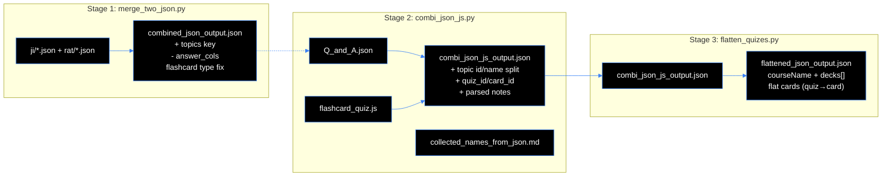
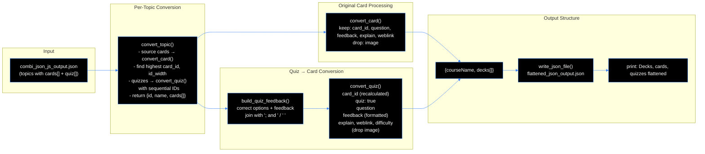

# Data cleaning
The problem: data lives in three files with different structures. It needs to be combined into a unified format.


## Summary of procedure
First all singular files containing questions (JSON) from two directories are merged into a single JSON file, ensuring a consistent structure and validating the keys (script `merge_two_json.py`).

Second the output of the first script combines with additional JS data, mapping questions to the appropriate topics and creating a unified structure for quizzes and flashcards (script `combi_json_js.py`).

Third the output of the second script is flattened into a unified structure with decks and cards, converting quizzes into cards where necessary (script `flatten_quizes.py`).

**Pipeline Overview (All Three Stages)**




## Summary of (`merge_two_json.py`)

This script merges question JSON files from two source directories into a single output file, applying several transformations to each question object.

### Key Functionalities

| Feature | Description |
|---------|-------------|
| **Input** | Two directory paths as positional arguments (`dir1`, `dir2`), with optional `-o/--output` flag for custom output path (default: `tools/scripts/cleaning/output/combined_json_output.json`) |
| **File Collection** | Gathers all `*.json` files from both directories using `glob` |
| **Topic Extraction** | Derives `"topics"` key from filename by stripping leading numbers and underscore (e.g., `01_Git_questions` → `Git_questions`) |
| **Key Validation** | Checks each question against valid top-level keys: `{"question", "type", "code", "answers"}` and reports any unexpected keys |
| **Processing Steps** (applied to each question): |
| 1. Adds `"topics"` key with extracted topic value |
| 2. Removes `"answer_cols"` key if present |
| 3. If `answers` array has exactly 1 element, changes `"type"` to `"flashcard"` |
| **Output** | Writes merged questions as JSON array to output file with `indent=4`, then prints summary count |

### Command Examples

```bash
# Default output
python tools/scripts/cleaning/merge_two_json.py tools/scripts/cleaning/input/ji tools/scripts/cleaning/input/rat

# Custom output path
python tools/scripts/cleaning/merge_two_json.py dir1 dir2 -o output.json
```

### Error Handling

- Warns if directory doesn't exist
- Skips files that aren't JSON arrays
- Catches `json.JSONDecodeError` and other exceptions, printing respective error messages

### Typical input structures

**From combined RAT and interview questions**


```ji
[
    {
        "question": "TF is?",
        "type": "multiple_choice",
        "answer_cols": 1,
        "answers": [
            {
                "code": "Click here for answer!",
                "correct": true,
                "feedback": "This is a flashcard, despite the name"
            }
        ]
    }
    {
        "question": "What TF?",
        "type": "many_choice",
        "answer_cols": 1,
        "answers": [
            {
                "code": "Click here for answer!",
                "correct": true,
                "feedback": "Even this is a flashcard, despite the name"
            }
        ]
    }
]

```


```rat
[
    {
        "question": "Only one?",
        "type": "multiple_choice",
        "answers": [
            {
                "answer": "no",
                "correct": false,
                "feedback": "Try again!"
            },
            {
                "answer": "no-no",
                "correct": false,
                "feedback": "Try again!"
            },
            {
                "answer": "yes",
                "correct": true,
                "feedback": "Correct text"
            }
        ]
    },
    {
        "question": "More than one?",
        "type": "many_choice",
        "answers": [
            {
                "answer": "Yeah",
                "correct": true,
                "feedback": "Correct text."
            },
            {
                "answer": "Nay",
                "correct": false,
                "feedback": "Try again!"
            },
            {
                "answer": "Yep",
                "correct": true,
                "feedback": "Correct text."
            },
            {
                "answer": "Nope",
                "correct": false,
                "feedback": "Try again!"
            },
        ]
    },
    {
        "question": "Another fkn flashcard?",
        "type": "multiple_choice",
        "answer_cols": 1,
        "answers": [
            {
                "answer": "Click here to see the answer.",
                "correct": true,
                "feedback": "Another fkn flashcard."
            }
        ]
    }
]

```
### Workflow of `merge_two_json.py`

```mermaid
graph LR
    %% arrow A --> B: B uses A; dashed = component of another section
    %% dashed arrow A -.-> B: transitive relation (data flow through module-level variables)
    classDef ext stroke: #3b82f6,stroke-dasharray: 4 3
    linkStyle default stroke: #3b82f6, color: #3b82f6
    classDef default fill: #000000ff, stroke: #3b82f6, color: #ffffffff

    subgraph sg_input["Input Sources"]
        dir1["dir1/*.json\n(ji/)"]
        dir2["dir2/*.json\n(rat/)"]
    end

    subgraph sg_collect["File Collection"]
        collect1["collect_json_files(dir1)"]
        collect2["collect_json_files(dir2)"]
        all_files["all_files = dir1_files + dir2_files"]
    end

    subgraph sg_process["Per-File Processing"]
        read["read_json_file()"]
        extract["extract_topics_from_filename()\n(strip leading digits + _)"]
        validate["validate_question_keys()\n(valid: question, type, code, answers)"]
        process["process_question()\n- add topics\n- remove answer_cols\n- type→flashcard if 1 answer"]
    end

    subgraph sg_output["Output"]
        write["json.dump(merged_questions, indent=4)"]
        summary["print summary: count, files"]
    end

    dir1 --> collect1
    dir2 --> collect2
    collect1 --> all_files
    collect2 --> all_files
    all_files --> read
    read --> extract
    read --> validate
    validate --> process
    extract --> process
    process --> write
    write --> summary
```




## Merge result above and quiz data (`combi_json_js.py`)

This script merges two data sources into a unified flashcard/quiz dataset:

### Input Files
1. **JSON file** (`Q_and_A.json`) — contains `q_a` entries with fields: `question`, `answers[]` (each with `answer`/`code`, `correct`, `feedback`), `type` (`flashcard` | `multiple_choice` | `many_choice`), `topics`, `code`, `weblink`, `difficulty`
2. **JS file** (`flashcard_quiz.js`) — contains a `const COURSE_DATA = { topics: [...] }` object with existing quiz/card structure

### Output Files
- **`combi_json_js_output.json`** — combined, normalized dataset
- **`collected_names_from_json.md`** — documentation report

---

### Core Processing Pipeline

| Stage | Description |
|-------|-------------|
| **1. Read & Parse** | `read_json_file()` loads JSON; `read_js_file()` extracts the `COURSE_DATA` object via regex and fixes JS→JSON syntax (unquoted keys, `null`/`undefined`) |
| **2. Map q_a → fc_quiz** | `map_qa_to_fc_quiz()` converts each JSON entry:<br>• `flashcard` → `cards[]` entry with `q`, `note` (from first answer's `feedback`), optional `explain`/`weblink`<br>• `multiple_choice`/`many_choice` → `quiz[]` entry with `q`, `options[]`, `answer` (index or list), `note[]` (per-option feedback list), `weblink`, `difficulty` |
| **3. Merge by Topic** | Matches `qa_entry['topics']` to `topic['name']` in the JS structure; appends mapped entries to `topic['quiz']` or `topic['cards']` |
| **4. Cleanup** | Recursively removes all `id` keys |
| **5. Parse Legacy Notes** | `process_existing_quiz_entries()` + `parse_quiz_note()` convert complex note strings (with `**Correct:**`, `**Wrong:**` bullets, `**Further Explanation:**`, `🔗 **WebLink:**`) into structured per-option `feedback[]` lists + `explain`; uses multi-strategy matching (`_match_wrong_option`) to align bullets to options |
| **6. Prune Empty Fields** | Removes empty `explain`/`weblink` keys |
| **7. Rename & Order Keys** | `q→question`, `note→feedback`, `answer→correct`; enforces key order: `quiz_id`/`card_id`, `question`, `options`, `correct`, `feedback`, …, `explain`, `image`, `weblink`, `difficulty` |
| **8. Topic ID Assignment** | Splits topic names like `"14. Neural Networks"` → `id: "15"` (number+1, zero-padded), `name: "Neural Networks"`; assigns sequential `quiz_id`/`card_id` (`"001"`, `"002"`, …) per topic |
| **9. Write Outputs** | JSON + Markdown report (unique topic names, unmatched wrong-answer bullets, missing topic numbers, topics without numbers) |
| **10. Console Reports** | Warns about missing topic matches, entries with `**WebLink:**` in note but no `weblink` key, and summary stats |

---

### Key Helper Functions

| Function | Purpose |
|----------|---------|
| `get_question_text()` | Appends question-level `code` as markdown code block |
| `get_answer_text()` | Prefers `answer`, falls back to `code` |
| `_match_wrong_option()` | 4-step fuzzy matching: exact → unbolded exact → substring → word-overlap |
| `parse_quiz_note()` | Parses structured note strings into per-option feedback list + `explain` + unmatched bullets |
| `remove_ids()` / `prune_empty_explain_weblink()` | Recursive cleanup |
| `rename_and_order_keys()` | Key rename + ordering + whitespace trimming |

---

### Run Command
```bash
python -B tools/scripts/cleaning/combi_json_js.py \
  tools/scripts/cleaning/input/Q_and_A.json \
  tools/scripts/cleaning/input/flashcard_quiz.js
```

### Typical Input Structures

**From quiz data**

```q_a
{
    {
        "question": "Can a multiple choice question have multiple correct answers?",
        "type": "multiple_choice",
        "answers": [
            {
                "answer": "Yes, multiple correct answers are possible.",
                "correct": false,
                "feedback": "Sorry, that is incorrect. Please try again."
            },
            {
                "answer": "No, multiple answers are possible, but just one answer is correct.",
                "correct": true,
                "feedback": "Correct, multiple_choice type questions have multiple answer options but only one correct answer."
            },
            {
                "answer": "No, selecting from multiple options does not match the definition of a multiple choice question.",
                "correct": false,
                "feedback": "Sorry, that is incorrect. Please try again."
            }
        ],
        "topics": "Mixed topic names"
    },
    {
        "question": "Which type of question allows multiple correct answers?",
        "type": "many_choice",
        "answers": [
            {
                "answer": "A many choice question allows multiple correct answers.",
                "correct": true,
                "feedback": "Correct, the question type which allows multiple correct answers is defined as 'many choice'."
            },
            {
                "answer": "It is a question with multiple answer options that allows multiple correct answers.",
                "correct": true,
                "feedback": "Correct, the question type which allows multiple correct answers is defined as 'many choice'."
            },
            {
                "answer": "A typical multiple choice question allows multiple answers.",
                "correct": false,
                "feedback": "Sorry, that is incorrect. Please try again."
            }
        ],
        "topics": "Some are called Day_x"
    },
    {
        "question": "What type of questions has only a single answer?",
        "type": "flashcard",
        "answers": [
            {
                "answer": "Click here to see the answer.",
                "correct": true,
                "feedback": "Flashcard has only a single answer. The answer is hidden in the feedback key, while the answer key is 'Click here to see the answer.'"
            }
        ],
        "topics": "Some match different topics."
    },
    {
        "question": "Is answer always the key?",
        "type": "flashcard",
        "answers": [
            {
                "code": "Click here for answer! is not the answer and should be ignored.",
                "correct": true,
                "feedback": "The answer lives in the feedback key."
            }
        ],
        "topics": "Manual review is required, luckily there are not too many"
    },

},
```

```fc_quiz
{
      "id": 1,
      "name": "1. Structured by Topics",
      "quiz": [
        {
          "q": "What is it?",
          "options": [
            "A GUI application",
            "A programming language",
            "A cloud service",
            "A distributed version"
          ],
          "answer": 3,
          "note": "**Correct:** A detailed answer. \n🔗 **WebLink:**",
          "weblink": "...",
          "difficulty": "easy"
        }
       
      ],
      "cards": [
        {
          "q": "Is there an answer for flashcards?",
          "note": "There is only an explanation, but no answer options.",
          "explain": "🔗 **WebLink:** deeper explanations are likely included.",
          "weblink": "..."
        }
      ]
    },
```

### Workflow of `combi_json_js.py`

```mermaid
graph LR
    %% arrow A --> B: B uses A; dashed = component of another section
    %% dashed arrow A -.-> B: transitive relation (data flow through module-level variables)
    classDef ext stroke: #3b82f6,stroke-dasharray: 4 3
    linkStyle default stroke: #3b82f6, color: #3b82f6
    classDef default fill: #000000ff, stroke: #3b82f6, color: #ffffffff

    subgraph sg_input["Input Files"]
        json_in["Q_and_A.json\n(q_a entries)"]
        js_in["flashcard_quiz.js\n(COURSE_DATA)"]
    end

    subgraph sg_parse["Parse & Extract"]
        read_json["read_json_file()"]
        read_js["read_js_file()\nregex + JS→JSON fix"]
    end

    subgraph sg_map["Map q_a → fc_quiz"]
        map["map_qa_to_fc_quiz()"]
        flashcard["flashcard → cards[]\nq, note, explain, weblink"]
        quiz["multiple_choice/many_choice → quiz[]\nq, options, answer, note[], weblink, difficulty"]
    end

    subgraph sg_merge["Merge by Topic"]
        match["match qa_entry['topics']\nto topic['name']"]
        append["append to topic['quiz']\nor topic['cards']"]
    end

    subgraph sg_cleanup["Cleanup & Transform"]
        remove_ids["remove_ids()\nrecursive id removal"]
        parse_notes["process_existing_quiz_entries()\nparse_quiz_note()\n- **Correct:**/**Wrong:** bullets\n- **Further Explanation:**\n- 🔗 **WebLink:**"]
        prune["prune_empty_explain_weblink()"]
        rename["rename_and_order_keys()\nq→question, note→feedback\nanswer→correct\nkey ordering"]
        topic_id["Topic ID Assignment\n'14. Name' → id:'15', name:'Name'\nquiz_id/card_id: '001','002'..."]
    end

    subgraph sg_output["Outputs"]
        write_json["combi_json_js_output.json"]
        write_md["collected_names_from_json.md\n- unique topics\n- unmatched wrong answers\n- missing topic numbers"]
        console["Console reports:\n- missing topic matches\n- weblink warnings\n- summary stats"]
    end

    json_in --> read_json
    js_in --> read_js
    read_json --> map
    read_js --> match
    map --> flashcard
    map --> quiz
    flashcard --> append
    quiz --> append
    match --> append
    append --> remove_ids
    remove_ids --> parse_notes
    parse_notes --> prune
    prune --> rename
    rename --> topic_id
    topic_id --> write_json
    topic_id --> write_md
    topic_id --> console
```




## Manually assigned topics from RATs and Job Interviews

### List of names used in the JSON file

- Bias_Variance_questions
- CNNs_questions
- Clustering_questions
- Day_02
- Day_03
- Day_04
- Day_05
- Day_06
- Day_07
- Day_08
- Day_09
- Day_10
- Day_12
- Day_13
- Day_14
- Day_15
- Day_16
- Day_17
- Day_18
- Day_19
- Decision_Trees_questions
- EDA_questions
- Ensemble_Methods_questions
- Evaluation_Metrics_questions
- Gradient_Descent_questions
- Intro_to_ML_questions
- KNN_questions
- Linear_Regression_questions
- Logistic_Regression_questions
- Python_1_questions
- Python_2_questions
- pandas_NumPy


### Manually assigned

- 0. Python, Pandas and NumPy
- 1. Git & Version Control Workflows
- 2. Data Science & ML Fundamentals
- 3. Databases & SQL Fundamentals

- 5. Exploratory Data Analysis & Visualization
- 6. Linear Regression
- 7. Bias-Variance Tradeoff & Regularization
- 8. Gradient Descent
- 9. Logistic Regression & Evaluation Metrics
- 10. K-Nearest Neighbors & Distance Metrics
- 11. Decision Trees & Ensemble Methods
- 12. Feature Engineering

- 15. Image Modeling & Convolutional Neural Networks (CNNs)
- 18. Probability Distributions & Confidence Intervals

- 20. Time Series Analysis
- 22. Clustering & Unsupervised Learning


## Quiz questions with unmatched wrong answers

### What is the cost function for **L1 regularization (Lasso)**?

- Unmatched wrong answer: *"$+\alpha\sum b_j^2$"*
- Unmatched wrong answer: *"$-\alpha\sum|b_j|$"*
- Unmatched wrong answer: *"penalty only"*
- Option without feedback: "$J(b) = \frac{1}{n}\sum(y-\hat{y})^2 - \alpha\sum|b_j|$"
- Option without feedback: "$J(b) = \alpha\sum|b_j|$"
- Option without feedback: "$J(b) = \frac{1}{n}\sum(y-\hat{y})^2 + \alpha\sum b_j^2$"

### What is the cost function for **L2 regularization (Ridge)**?

- Unmatched wrong answer: *"$+\alpha\sum|b_j|$"*
- Unmatched wrong answer: *"multiplied terms"*
- Unmatched wrong answer: *"penalty only"*
- Option without feedback: "$J(b) = \frac{1}{n}\sum(y-\hat{y})^2 \times \alpha\sum b_j^2$"
- Option without feedback: "$J(b) = \alpha\sum b_j^2$"
- Option without feedback: "$J(b) = \frac{1}{n}\sum(y-\hat{y})^2 + \alpha\sum|b_j|$"

### Which statement best describes **gradient descent**?

- Unmatched wrong answer: *"outlier removal"*
- Option without feedback: "A technique for **removing outliers** from a dataset"

### What is the formula for **precision**?

- Unmatched wrong answer: *"$\frac{TP}{TP+FN}$"*
- Unmatched wrong answer: *"$\frac{TN}{TN+FP}$"*
- Option without feedback: "$\text{Precision} = \frac{TN}{TN+FP}$"
- Option without feedback: "$\text{Precision} = \frac{TP}{TP+FN}$"

### What is the formula for **recall (sensitivity)**?

- Unmatched wrong answer: *"$\frac{TP}{TP+FP}$"*
- Unmatched wrong answer: *"$\frac{FP}{TP+FP}$"*
- Option without feedback: "$\text{Recall} = \frac{TP}{TP+FP}$"
- Option without feedback: "$\text{Recall} = \frac{FP}{TP+FP}$"

### What is **Bagging (Bootstrap Aggregating)**?

- Unmatched wrong answer: *"sequential residual correction"*
- Option without feedback: "Training one model sequentially, correcting its own residuals over several rounds"

### Increasing a tree's **max_depth** moves it in which direction on the bias-variance axis?

- Unmatched wrong answer: *"reversed"*
- Option without feedback: "Toward higher bias / lower variance"

## Test

**Quantity Check**
- Number of "question" keys in Q&A: 107
- Number of "q" keys in fc_quiz: 1563
- Number of "q" keys in combi.json: 1670
- Number of "note": keys in combi.json: 1670

Validation: 1670-1563-107 = 0; all questions accounted for, before key corrections

- Number of "questiion": keys in combi.json: 578
- Number of "answer": keys in combi.json: 578

Validation: all multiple/many choice questions have an "answer" key

- Number of "note": keys with list values in combi.json: 29
- Number of "answer": keys with list values in combi.json: 29
- Number of "type": "many_choice" in Q_A.json: 29

Validation: many choice questions' correct answers lists are mapped

**Quality Check**
- No 'Click here for answer!' etc. from flashcards mapped.
- All "code" entries are accounted for and properly recognized where those are part of the question or part of the answer .
- many choice questions' correct answers are mapped as lists, therefore values "note": ["That's correct! ", "That's correct! "] exist, which is expected and indicates proper mapping.
- "difficulty": is only true for quiz questions.


## Summary of (`flatten_quizes.py`)

The script `flatten_quizes.py` is a data-cleaning utility that transforms a nested JSON structure (containing topics with separate cards and quizzes) into a flat, normalized format where each topic becomes a deck containing a single unified list of cards.

---

### Input / Output

| Artifact | Path |
|---|---|
| **Input** | `tools/scripts/cleaning/input/combi_json_js_output.json` |
| **Output** | `tools/scripts/cleaning/output/flattened_json_output.json` (created if missing) |

---

### Transformation Logic

#### 1. Topic → Deck Mapping

Each source `topic` becomes a target `deck` with:
- `id` — preserved from the topic
- `name` — preserved from the topic
- `cards` — a single flat list combining original cards and converted quizzes

#### 2. Original Card Processing

Each source card is converted by `convert_card()`:
- Keeps only these keys: `card_id`, `question`, `feedback`, `explain`, `weblink`
- Drops the `image` key entirely
- Keys not present in a given card are simply omitted (no error)

#### 3. Quiz → Card Conversion

Each source quiz is converted by `convert_quiz()` into a card entry with:

| Field | Description |
|---|---|
| `card_id` | Recalculated from the quiz's position, continuing the count after the highest `card_id` among the topic's original cards. New ID is zero-padded to match the width of original card IDs (e.g., if original cards use "001".."015", the first quiz becomes "016"). |
| `quiz` | Set to `true` — marks cards that originate from a quiz |
| `question` | Copied directly from the quiz |
| `feedback` | Built by `build_quiz_feedback()` — format is `"<correct option(s)>: <feedback of correct option(s)>"` |
| `explain`, `weblink`, `difficulty` | Copied from the quiz if present |
| `image` | Dropped (not included) |

**Feedback formatting** (`build_quiz_feedback`):
- Correct options are joined with `"; and "` (e.g., `"A; and B: Great job!"`)
- Correct feedbacks are joined with `" "` (space)
- Duplicate feedback strings from multiple correct answers are de-duplicated
- If a quiz has no `correct` field, no `feedback` key is added

#### 4. Top-Level Structure

The output JSON has:
- `courseName` — copied from source if present
- `decks` — array of converted decks

---

### Key Constants

| Constant | Value | Purpose |
|---|---|---|
| `CARD_KEYS` | `("card_id", "question", "feedback", "explain", "weblink")` | Keys to keep from original cards |
| `QUIZ_COPY_KEYS` | `("explain", "weblink", "difficulty")` | Keys to optionally copy from quizzes |
| `OPTION_SEPARATOR` | `"; and "` | Joins multiple correct options in feedback |
| `FEEDBACK_SEPARATOR` | `" "` | Joins multiple correct feedback strings |

---

### Functions (in call order)

1. **`read_json_file(file_path)`** — Reads and parses a UTF-8 JSON file.
2. **`write_json_file(file_path, data)`** — Writes data as pretty-printed JSON (2-space indent, `ensure_ascii=False`), creating parent directories as needed.
3. **`convert_card(card)`** — Extracts only the relevant keys from a source card, dropping `image`.
4. **`build_quiz_feedback(quiz)`** — Constructs the formatted feedback string from a quiz's correct options and their feedback.
5. **`convert_quiz(quiz, card_id)`** — Builds a flat card entry from a quiz.
6. **`convert_topic(topic)`** — Orchestrates card + quiz conversion for one topic, computing new quiz card IDs.
7. **`main()`** — Reads input, transforms all topics, writes output, prints summary statistics.

---

### Statistics Printed on Completion

```
Decks: N, cards: M, quizzes flattened: Q
Output written to <path>
```

- Number of decks (topics)
- Total cards processed (original cards across all topics, including converted quizzes)
- Number of quizzes flattened
- Output file path

---

### Usage

```bash
python -B tools/scripts/cleaning/flatten_quizes.py
```

The `-B` flag prevents writing `.pyc` bytecode files.

---

### Notes

- This script is a **one-way normalization tool** — it does not modify the original input file.
- The output structure is flat and consistent, making it easier to work with in downstream flashcard applications.
- Quiz card IDs are sequentially assigned starting from `highest_source_card_id + 1`, with zero-padding preserved from the original card ID format.

### Workflow of `flatten_quizes.py`




## Outlook

More data such as explainer slides and exercises lives in Jupyter notebooks. It is intended to use as content and will be structured in a separate step.

