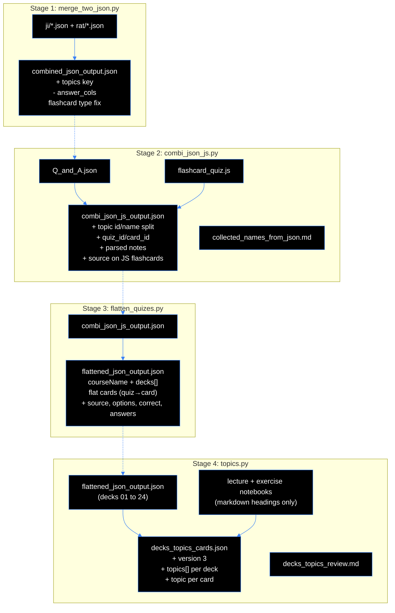
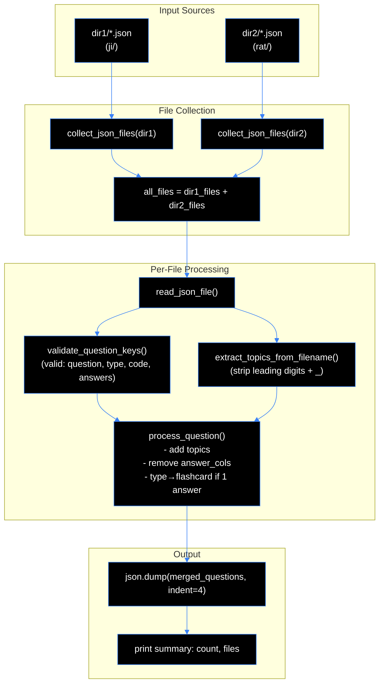
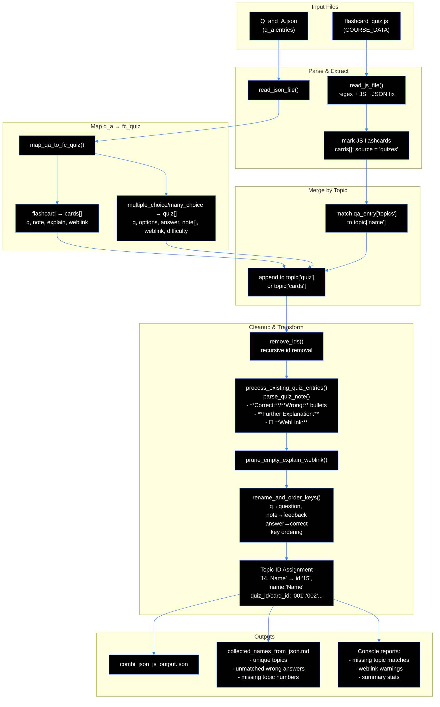
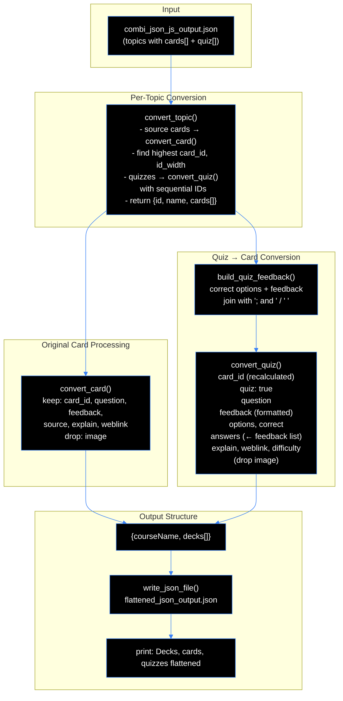
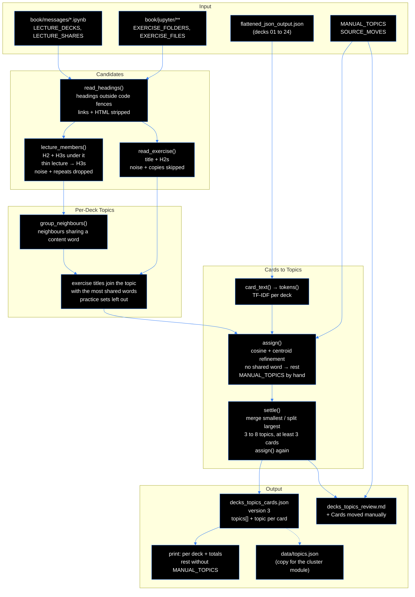

# Data cleaning
The problem: data lives in three files with different structures. It needs to be combined into a unified format.


## Summary of procedure
First all singular files containing questions (JSON) from two directories are merged into a single JSON file, ensuring a consistent structure and validating the keys (script `merge_two_json.py`).

Second the output of the first script combines with additional JS data, mapping questions to the appropriate topics and creating a unified structure for quizzes and flashcards (script `combi_json_js.py`).

Third the output of the second script is flattened into a unified structure with decks and cards, converting quizzes into cards where necessary (script `flatten_quizes.py`).

Fourth the decks 01 to 24 of the third script's output get heuristic topics: the cards of each deck are grouped under topics found in the headings of the lecture and exercise notebooks, and the result is written as cards.json version 3 (script `topics.py`).

Each script reads from `scripts/input/` and writes to `scripts/output/`. The output of a stage has to be copied into `scripts/input/` before the next stage runs.

```powershell
# stages 2 to 4 after a change in Q_and_A.json or flashcard_quiz.js
.venv/Scripts/python.exe -B scripts/combi_json_js.py scripts/input/Q_and_A.json scripts/input/flashcard_quiz.js
Copy-Item scripts/output/combi_json_js_output.json scripts/input/combi_json_js_output.json
.venv/Scripts/python.exe -B scripts/flatten_quizes.py
Copy-Item scripts/output/flattened_json_output.json scripts/input/flattened_json_output.json
.venv/Scripts/python.exe -B -I scripts/topics.py
Copy-Item scripts/output/decks_topics_cards.json data/topics.json
```

**Pipeline Overview (All Four Stages)**




## Summary of (`merge_two_json.py`)

This script merges question JSON files from two source directories into a single output file, applying several transformations to each question object.

### Key Functionalities

| Feature | Description |
|---------|-------------|
| **Input** | Two directory paths as positional arguments (`dir1`, `dir2`), with optional `-o/--output` flag for custom output path (default: `./scripts/output/combined_json_output.json`) |
| **File Collection** | Gathers all `*.json` files from both directories using `glob` |
| **Topic Extraction** | Derives `"topics"` key from filename by stripping leading numbers and underscore (e.g., `01_Git_questions` → `Git_questions`) |
| **Key Validation** | Checks each question against valid top-level keys: `{"question", "type", "code", "answers"}` and reports any unexpected keys |
| **Processing Steps** (applied to each question): |
| 1. Adds `"topics"` key with extracted topic value |
| 2. Removes `"answer_cols"` key if present |
| 3. If `answers` array has exactly 1 element, changes `"type"` to `"flashcard"` |
| **Output** | Writes merged questions as JSON array to output file with `indent=4`, then prints summary count |

### Command Examples

```bash
# Default output
python ./scripts/merge_two_json.py ./scripts/input/ji ./scripts/input/rat

# Custom output path
python ./scripts/merge_two_json.py dir1 dir2 -o output.json
```

### Error Handling

- Warns if directory doesn't exist
- Skips files that aren't JSON arrays
- Catches `json.JSONDecodeError` and other exceptions, printing respective error messages

### Typical input structures

**From combined RAT and interview questions**


```ji
[
    {
        "question": "TF is?",
        "type": "multiple_choice",
        "answer_cols": 1,
        "answers": [
            {
                "code": "Click here for answer!",
                "correct": true,
                "feedback": "This is a flashcard, despite the name"
            }
        ]
    }
    {
        "question": "What TF?",
        "type": "many_choice",
        "answer_cols": 1,
        "answers": [
            {
                "code": "Click here for answer!",
                "correct": true,
                "feedback": "Even this is a flashcard, despite the name"
            }
        ]
    }
]

```


```rat
[
    {
        "question": "Only one?",
        "type": "multiple_choice",
        "answers": [
            {
                "answer": "no",
                "correct": false,
                "feedback": "Try again!"
            },
            {
                "answer": "no-no",
                "correct": false,
                "feedback": "Try again!"
            },
            {
                "answer": "yes",
                "correct": true,
                "feedback": "Correct text"
            }
        ]
    },
    {
        "question": "More than one?",
        "type": "many_choice",
        "answers": [
            {
                "answer": "Yeah",
                "correct": true,
                "feedback": "Correct text."
            },
            {
                "answer": "Nay",
                "correct": false,
                "feedback": "Try again!"
            },
            {
                "answer": "Yep",
                "correct": true,
                "feedback": "Correct text."
            },
            {
                "answer": "Nope",
                "correct": false,
                "feedback": "Try again!"
            },
        ]
    },
    {
        "question": "Another flashcard?",
        "type": "multiple_choice",
        "answer_cols": 1,
        "answers": [
            {
                "answer": "Click here to see the answer.",
                "correct": true,
                "feedback": "Another flashcard."
            }
        ]
    }
]

```
### Workflow of `merge_two_json.py`




## Merge result above and quiz data (`combi_json_js.py`)

This script merges two data sources into a unified flashcard/quiz dataset:

### Input Files
1. **JSON file** (`Q_and_A.json`) — contains `q_a` entries with fields: `question`, `answers[]` (each with `answer`/`code`, `correct`, `feedback`), `type` (`flashcard` | `multiple_choice` | `many_choice`), `topics`, `code`, `weblink`, `difficulty`
2. **JS file** (`flashcard_quiz.js`) — contains a `const COURSE_DATA = { topics: [...] }` object with existing quiz/card structure

### Output Files
- **`combi_json_js_output.json`** — combined, normalized dataset; the flashcards of the JS file carry `"source": "quizes"`
- **`collected_names_from_json.md`** — documentation report

---

### Core Processing Pipeline

| Stage | Description |
|-------|-------------|
| **1. Read & Parse** | `read_json_file()` loads JSON; `read_js_file()` extracts the `COURSE_DATA` object via regex and fixes JS→JSON syntax (unquoted keys, `null`/`undefined`) |
| **2. Mark JS Flashcards** | Before the q_a entries are added, every entry in the JS file's `cards[]` gets `"source": "quizes"`. The JS quizzes need no mark: they carry a `difficulty`, the q_a quizzes don't. So the origin of every card stays visible after the merge (on 2026-10-25: 1,041 JS flashcards with `source`, 51 q_a flashcards without) |
| **3. Map q_a → fc_quiz** | `map_qa_to_fc_quiz()` converts each JSON entry:<br>• `flashcard` → `cards[]` entry with `q`, `note` (from first answer's `feedback`), optional `explain`/`weblink`<br>• `multiple_choice`/`many_choice` → `quiz[]` entry with `q`, `options[]`, `answer` (index or list), `note[]` (per-option feedback list), `weblink`, `difficulty` |
| **4. Merge by Topic** | Matches `qa_entry['topics']` to `topic['name']` in the JS structure; appends mapped entries to `topic['quiz']` or `topic['cards']` |
| **5. Cleanup** | Recursively removes all `id` keys |
| **6. Parse Legacy Notes** | `process_existing_quiz_entries()` + `parse_quiz_note()` convert complex note strings (with `**Correct:**`, `**Wrong:**` bullets, `**Further Explanation:**`, `🔗 **WebLink:**`) into structured per-option `feedback[]` lists + `explain`; uses multi-strategy matching (`_match_wrong_option`) to align bullets to options |
| **7. Prune Empty Fields** | Removes empty `explain`/`weblink` keys |
| **8. Rename & Order Keys** | `q→question`, `note→feedback`, `answer→correct`; enforces key order: `quiz_id`/`card_id`, `question`, `options`, `correct`, `feedback`, … (e.g. `source`), `explain`, `image`, `weblink`, `difficulty` |
| **9. Topic ID Assignment** | Splits topic names like `"14. Neural Networks"` → `id: "15"` (number+1, zero-padded), `name: "Neural Networks"`; assigns sequential `quiz_id`/`card_id` (`"001"`, `"002"`, …) per topic |
| **10. Write Outputs** | JSON + Markdown report (unique topic names, unmatched wrong-answer bullets, missing topic numbers, topics without numbers) |
| **11. Console Reports** | Warns about missing topic matches, entries with `**WebLink:**` in note but no `weblink` key, and summary stats |

---

### Key Helper Functions

| Function | Purpose |
|----------|---------|
| `get_question_text()` | Appends question-level `code` as markdown code block |
| `get_answer_text()` | Prefers `answer`, falls back to `code` |
| `_match_wrong_option()` | 4-step fuzzy matching: exact → unbolded exact → substring → word-overlap |
| `parse_quiz_note()` | Parses structured note strings into per-option feedback list + `explain` + unmatched bullets |
| `remove_ids()` / `prune_empty_explain_weblink()` | Recursive cleanup |
| `rename_and_order_keys()` | Key rename + ordering + whitespace trimming |

---

### Run Command
```bash
python -B ./scripts/combi_json_js.py \
  ./scripts/input/Q_and_A.json \
  ./scripts/input/flashcard_quiz.js
```

### Typical Input Structures

**From quiz data**

```q_a
{
    {
        "question": "Can a multiple choice question have multiple correct answers?",
        "type": "multiple_choice",
        "answers": [
            {
                "answer": "Yes, multiple correct answers are possible.",
                "correct": false,
                "feedback": "Sorry, that is incorrect. Please try again."
            },
            {
                "answer": "No, multiple answers are possible, but just one answer is correct.",
                "correct": true,
                "feedback": "Correct, multiple_choice type questions have multiple answer options but only one correct answer."
            },
            {
                "answer": "No, selecting from multiple options does not match the definition of a multiple choice question.",
                "correct": false,
                "feedback": "Sorry, that is incorrect. Please try again."
            }
        ],
        "topics": "Mixed topic names"
    },
    {
        "question": "Which type of question allows multiple correct answers?",
        "type": "many_choice",
        "answers": [
            {
                "answer": "A many choice question allows multiple correct answers.",
                "correct": true,
                "feedback": "Correct, the question type which allows multiple correct answers is defined as 'many choice'."
            },
            {
                "answer": "It is a question with multiple answer options that allows multiple correct answers.",
                "correct": true,
                "feedback": "Correct, the question type which allows multiple correct answers is defined as 'many choice'."
            },
            {
                "answer": "A typical multiple choice question allows multiple answers.",
                "correct": false,
                "feedback": "Sorry, that is incorrect. Please try again."
            }
        ],
        "topics": "Some are called Day_x"
    },
    {
        "question": "What type of questions has only a single answer?",
        "type": "flashcard",
        "answers": [
            {
                "answer": "Click here to see the answer.",
                "correct": true,
                "feedback": "Flashcard has only a single answer. The answer is hidden in the feedback key, while the answer key is 'Click here to see the answer.'"
            }
        ],
        "topics": "Some match different topics."
    },
    {
        "question": "Is answer always the key?",
        "type": "flashcard",
        "answers": [
            {
                "code": "Click here for answer! is not the answer and should be ignored.",
                "correct": true,
                "feedback": "The answer lives in the feedback key."
            }
        ],
        "topics": "Manual review is required, luckily there are not too many"
    },

},
```

```fc_quiz
{
      "id": 1,
      "name": "1. Structured by Topics",
      "quiz": [
        {
          "q": "What is it?",
          "options": [
            "A GUI application",
            "A programming language",
            "A cloud service",
            "A distributed version"
          ],
          "answer": 3,
          "note": "**Correct:** A detailed answer. \n🔗 **WebLink:**",
          "weblink": "...",
          "difficulty": "easy"
        }
       
      ],
      "cards": [
        {
          "q": "Is there an answer for flashcards?",
          "note": "There is only an explanation, but no answer options.",
          "explain": "🔗 **WebLink:** deeper explanations are likely included.",
          "weblink": "..."
        }
      ]
    },
```

### Workflow of `combi_json_js.py`




## Manually assigned topics from RATs and Job Interviews

### List of names used in the JSON file

- Bias_Variance_questions
- CNNs_questions
- Clustering_questions
- Day_02
- Day_03
- Day_04
- Day_05
- Day_06
- Day_07
- Day_08
- Day_09
- Day_10
- Day_12
- Day_13
- Day_14
- Day_15
- Day_16
- Day_17
- Day_18
- Day_19
- Decision_Trees_questions
- EDA_questions
- Ensemble_Methods_questions
- Evaluation_Metrics_questions
- Gradient_Descent_questions
- Intro_to_ML_questions
- KNN_questions
- Linear_Regression_questions
- Logistic_Regression_questions
- Python_1_questions
- Python_2_questions
- pandas_NumPy


### Manually assigned

- 0. Python, Pandas and NumPy
- 1. Git & Version Control Workflows
- 2. Data Science & ML Fundamentals
- 3. Databases & SQL Fundamentals

- 5. Exploratory Data Analysis & Visualization
- 6. Linear Regression
- 7. Bias-Variance Tradeoff & Regularization
- 8. Gradient Descent
- 9. Logistic Regression & Evaluation Metrics
- 10. K-Nearest Neighbors & Distance Metrics
- 11. Decision Trees & Ensemble Methods
- 12. Feature Engineering

- 14. Neural Networks & Deep Learning
- 15. Image Modeling & Convolutional Neural Networks (CNNs)
- 18. Probability Distributions & Confidence Intervals

- 20. Time Series Analysis
- 21. Dimensionality Reduction
- 22. Clustering & Unsupervised Learning


### Manual changes in `Q_and_A.json`

Changes compared to `scripts/input/Q_and_A_unmodified.bak`:

| Change | Entries | Detail |
|---|---|---|
| Topic assigned by hand | all 101 | The name taken from the file name is replaced by a deck name of `flashcard_quiz.js` (table below) |
| New entries | 6 | 2 flashcards on correlation for "2. Data Science & ML Fundamentals"; 4 entries for "22. Clustering & Unsupervised Learning" (2 multiple choice, 1 many choice, 1 flashcard) |
| Type corrected | 3 | `multiple_choice` → `many_choice` for questions with more than one correct answer; the last character of their question changed from "." to "?" |

Entries: 101 → 107 (one question, "What will the following code return?", is in the file twice, before and after). Types: `flashcard` 48 → 51, `multiple_choice` 28 → 27, `many_choice` 25 → 29.

The names of the RAT files do not match their content, e.g. `Clustering_questions` holds CNN questions, `Decision_Trees_questions` KNN questions and `Intro_to_ML_questions` Git questions. The topics follow the content:

| Name in the JSON file | Assigned topic (entries) |
|---|---|
| `Bias_Variance_questions` | 6. Linear Regression (4) |
| `Clustering_questions` | 15. Image Modeling & Convolutional Neural Networks (CNNs) (5) |
| `CNNs_questions` | 11. Decision Trees & Ensemble Methods (5) |
| `Day_02` | 7. Bias-Variance Tradeoff & Regularization (2) |
| `Day_03` | 2. Data Science & ML Fundamentals (1)<br>5. Exploratory Data Analysis & Visualization (1) |
| `Day_04` | 2. Data Science & ML Fundamentals (1)<br>8. Gradient Descent (1) |
| `Day_05` | 11. Decision Trees & Ensemble Methods (2) |
| `Day_06` | 2. Data Science & ML Fundamentals (1)<br>5. Exploratory Data Analysis & Visualization (1) |
| `Day_07` | 5. Exploratory Data Analysis & Visualization (2) |
| `Day_08` | 21. Dimensionality Reduction (2) |
| `Day_09` | 3. Databases & SQL Fundamentals (2) |
| `Day_10` | 9. Logistic Regression & Evaluation Metrics (2) |
| `Day_12` | 2. Data Science & ML Fundamentals (1)<br>11. Decision Trees & Ensemble Methods (1) |
| `Day_13` | 2. Data Science & ML Fundamentals (1)<br>14. Neural Networks & Deep Learning (2) |
| `Day_14` | 2. Data Science & ML Fundamentals (2) |
| `Day_15` | 20. Time Series Analysis (1) |
| `Day_16` | 12. Feature Engineering (2) |
| `Day_17` | 2. Data Science & ML Fundamentals (1)<br>12. Feature Engineering (1) |
| `Day_18` | 18. Probability Distributions & Confidence Intervals (2) |
| `Day_19` | 2. Data Science & ML Fundamentals (1)<br>9. Logistic Regression & Evaluation Metrics (1) |
| `Decision_Trees_questions` | 10. K-Nearest Neighbors & Distance Metrics (5) |
| `EDA_questions` | 0. Python, Pandas and NumPy (5) |
| `Ensemble_Methods_questions` | 11. Decision Trees & Ensemble Methods (5) |
| `Evaluation_Metrics_questions` | 8. Gradient Descent (4) |
| `Gradient_Descent_questions` | 7. Bias-Variance Tradeoff & Regularization (5) |
| `Intro_to_ML_questions` | 1. Git & Version Control Workflows (5) |
| `KNN_questions` | 9. Logistic Regression & Evaluation Metrics (4) |
| `Linear_Regression_questions` | 5. Exploratory Data Analysis & Visualization (5) |
| `Logistic_Regression_questions` | 9. Logistic Regression & Evaluation Metrics (4) |
| `pandas_NumPy` | 0. Python, Pandas and NumPy (4) |
| `Python_1_questions` | 2. Data Science & ML Fundamentals (3) |
| `Python_2_questions` | 0. Python, Pandas and NumPy (4) |

The deck id is the topic's number plus one (`combi_json_js.py`, stage 9): "1. Git & Version Control Workflows" is deck 02. Reason is that deck 01 is created systematically only from rats and ji (job interview) non-quiz topics.


## Cards moved manually in `flashcard_quiz.js`

 The quiz deck "2. Data Science & ML Fundamentals" (deck 03) contained 11 cards related to Git. These 11 Git flashcards were moved by hand into deck "1. Git & Version Control Workflows" (deck 02)  in `scripts/input/flashcard_quiz.js`. All 11 are plain cards of the JS file (`"source": "quizes"`). 8 of them were found through the heuristic rest topic of the first `topics.py` run: they share no word with any heading of deck 03. The other 3 were found by reading deck 03's cards manually; there they had matched a topic by chance.

| Deck 03, card before | Deck 02, card now | Subject | Found by |
|---|---|---|---|
| 012 | 032 | Git's three stages (image) | rest topic |
| 013 | 033 | `git commit` | rest topic |
| 014 | 034 | Pull request | rest topic |
| 015 | 035 | Repository and remote | rest topic |
| 021 | 036 | `git fetch` and `git pull` | rest topic |
| 022 | 037 | Merge conflict | rest topic |
| 024 | 038 | `git stash` | rest topic |
| 027 | 039 | `git clone` and `git init` | rest topic |
| 016 | 040 | Merge and rebase (image) | reading |
| 023 | 041 | `.gitignore` | reading |
| 029 | 042 | Version control for data science | reading |

Effects on the flattened decks (`card_id` counts per deck, the quizzes follow the plain cards):

| Deck | Before | After |
|---|---|---|
| 02 | 48 cards: plain 001–031, quizzes 032–048 | 59 cards: plain 001–042 (moved 032–042), quizzes 043–059 |
| 03 | 56 cards: plain 001–042, quizzes 043–056 | 45 cards: plain 001–031, quizzes 032–045 |

The ids of the cards after the first moved card in deck 03 and of all quizzes in decks 02 and 03 shift, and with them the cards' comb ids (stack + deck id + card id): learning states saved with the old ids do not match these decks any more. The exact question starts and reasons are in the table `SOURCE_MOVES` of `topics.py` and in the last chapter of `decks_topics_review.md`.


## Quiz questions with unmatched wrong answers
The following quiz questions have wrong answers that don't match any correct option. They were detected by the script and edited manually by sorting the wrong answer options into the feedback entries.

### What is the cost function for **L1 regularization (Lasso)**?

- Unmatched wrong answer: *"$+\alpha\sum b_j^2$"*
- Unmatched wrong answer: *"$-\alpha\sum|b_j|$"*
- Unmatched wrong answer: *"penalty only"*
- Option without feedback: "$J(b) = \frac{1}{n}\sum(y-\hat{y})^2 - \alpha\sum|b_j|$"
- Option without feedback: "$J(b) = \alpha\sum|b_j|$"
- Option without feedback: "$J(b) = \frac{1}{n}\sum(y-\hat{y})^2 + \alpha\sum b_j^2$"

### What is the cost function for **L2 regularization (Ridge)**?

- Unmatched wrong answer: *"$+\alpha\sum|b_j|$"*
- Unmatched wrong answer: *"multiplied terms"*
- Unmatched wrong answer: *"penalty only"*
- Option without feedback: "$J(b) = \frac{1}{n}\sum(y-\hat{y})^2 \times \alpha\sum b_j^2$"
- Option without feedback: "$J(b) = \alpha\sum b_j^2$"
- Option without feedback: "$J(b) = \frac{1}{n}\sum(y-\hat{y})^2 + \alpha\sum|b_j|$"

### Which statement best describes **gradient descent**?

- Unmatched wrong answer: *"outlier removal"*
- Option without feedback: "A technique for **removing outliers** from a dataset"

### What is the formula for **precision**?

- Unmatched wrong answer: *"$\frac{TP}{TP+FN}$"*
- Unmatched wrong answer: *"$\frac{TN}{TN+FP}$"*
- Option without feedback: "$\text{Precision} = \frac{TN}{TN+FP}$"
- Option without feedback: "$\text{Precision} = \frac{TP}{TP+FN}$"

### What is the formula for **recall (sensitivity)**?

- Unmatched wrong answer: *"$\frac{TP}{TP+FP}$"*
- Unmatched wrong answer: *"$\frac{FP}{TP+FP}$"*
- Option without feedback: "$\text{Recall} = \frac{TP}{TP+FP}$"
- Option without feedback: "$\text{Recall} = \frac{FP}{TP+FP}$"

### What is **Bagging (Bootstrap Aggregating)**?

- Unmatched wrong answer: *"sequential residual correction"*
- Option without feedback: "Training one model sequentially, correcting its own residuals over several rounds"

### Increasing a tree's **max_depth** moves it in which direction on the bias-variance axis?

- Unmatched wrong answer: *"reversed"*
- Option without feedback: "Toward higher bias / lower variance"

## Test

**Quantity Check**
- Number of "question" keys in Q&A: 107
- Number of "q" keys in fc_quiz: 1563
- Number of "q" keys in combi.json: 1670
- Number of "note": keys in combi.json: 1670

Validation: 1670-1563-107 = 0; all questions accounted for, before key corrections

- Number of "questiion": keys in combi.json: 578
- Number of "answer": keys in combi.json: 578

Validation: all multiple/many choice questions have an "answer" key

- Number of "note": keys with list values in combi.json: 29
- Number of "answer": keys with list values in combi.json: 29
- Number of "type": "many_choice" in Q_A.json: 29

Validation: many choice questions' correct answers lists are mapped

**Quality Check**
- No 'Click here for answer!' etc. from flashcards mapped.
- All "code" entries are accounted for and properly recognized where those are part of the question or part of the answer .
- many choice questions' correct answers are mapped as lists, therefore values "note": ["That's correct! ", "That's correct! "] exist, which is expected and indicates proper mapping.
- "difficulty": is only true for quiz questions.


## Summary of (`flatten_quizes.py`)

The script `flatten_quizes.py` is a data-cleaning utility that transforms a nested JSON structure (containing topics with separate cards and quizzes) into a flat, normalized format where each topic becomes a deck containing a single unified list of cards.

---

### Input / Output

| Artifact | Path |
|---|---|
| **Input** | `scripts/input/combi_json_js_output.json` (copy of stage 2's `scripts/output/combi_json_js_output.json`) |
| **Output** | `scripts/output/flattened_json_output.json` (created if missing) |

---

### Transformation Logic

#### 1. Topic → Deck Mapping

Each source `topic` becomes a target `deck` with:
- `id` — preserved from the topic
- `name` — preserved from the topic
- `cards` — a single flat list combining original cards and converted quizzes

#### 2. Original Card Processing

Each source card is converted by `convert_card()`:
- Keeps only these keys: `card_id`, `question`, `feedback`, `source`, `explain`, `weblink`
- `source` is `"quizes"` for the flashcards of `flashcard_quiz.js` (set by `combi_json_js.py`); the flashcards of `Q_and_A.json` have no `source`
- Drops the `image` key entirely
- Keys not present in a given card are simply omitted (no error)

#### 3. Quiz → Card Conversion

Each source quiz is converted by `convert_quiz()` into a card entry with:

| Field | Description |
|---|---|
| `card_id` | Recalculated from the quiz's position, continuing the count after the highest `card_id` among the topic's original cards. New ID is zero-padded to match the width of original card IDs (e.g., if original cards use "001".."015", the first quiz becomes "016"). |
| `quiz` | Set to `true` — marks cards that originate from a quiz |
| `question` | Copied directly from the quiz |
| `feedback` | Built by `build_quiz_feedback()` — format is `"<correct option(s)>: <feedback of correct option(s)>"` |
| `options` | Copied from the quiz: all answer options |
| `correct` | Copied from the quiz: the index of the correct option (int, single choice) or the indexes (list, multiple choice) |
| `answers` | The quiz's source `feedback` list, one text per option (the target `feedback` is the built text above) |
| `explain`, `weblink`, `difficulty` | Copied from the quiz if present |
| `image` | Dropped (not included) |

The keys are written in this order: `card_id`, `quiz`, `question`, `feedback`, `options`, `correct`, `answers`, `explain`, `weblink`, `difficulty`.

**Feedback formatting** (`build_quiz_feedback`):
- Correct options are joined with `"; and "` (e.g., `"A; and B: Great job!"`)
- Correct feedbacks are joined with `" "` (space)
- Duplicate feedback strings from multiple correct answers are de-duplicated
- If a quiz has no `correct` field, no `feedback` key is added

#### 4. Top-Level Structure

The output JSON has:
- `courseName` — copied from source if present
- `decks` — array of converted decks

#### 5. Card Types Kept Visible

The app reads none of `source`, `options`, `correct` and `answers` (cards.json version 2 ignores them). They keep every card type visible in the data:

| Card type | Recognized by | Cards (version 3) |
|---|---|---|
| Plain card from `Q_and_A.json` | no `quiz`, no `source` | 51 |
| Plain card from `flashcard_quiz.js` | no `quiz`, `"source": "quizes"` | 1,041 |
| Single choice quiz | `"quiz": true`, `correct` is an int | 549 |
| Multiple choice quiz | `"quiz": true`, `correct` is a list | 29 |
| Rated quiz | `difficulty` present (quizzes only) | 522 of the 578 quizzes |

---

### Key Constants

| Constant | Value | Purpose |
|---|---|---|
| `CARD_KEYS` | `("card_id", "question", "feedback", "source", "explain", "weblink")` | Keys to keep from original cards |
| `QUIZ_COPY_KEYS` | `{"options": "options", "correct": "correct", "answers": "feedback", "explain": "explain", "weblink": "weblink", "difficulty": "difficulty"}` | Target key → source key, copied from quizzes where present and in this order; `answers` takes the source `feedback` list |
| `OPTION_SEPARATOR` | `"; and "` | Joins multiple correct options in feedback |
| `FEEDBACK_SEPARATOR` | `" "` | Joins multiple correct feedback strings |

---

### Functions (in call order)

1. **`read_json_file(file_path)`** — Reads and parses a UTF-8 JSON file.
2. **`write_json_file(file_path, data)`** — Writes data as pretty-printed JSON (2-space indent, `ensure_ascii=False`, final newline), creating parent directories as needed.
3. **`convert_card(card)`** — Extracts only the keys of `CARD_KEYS` from a source card, dropping `image`.
4. **`build_quiz_feedback(quiz)`** — Constructs the formatted feedback string from a quiz's correct options and their feedback.
5. **`convert_quiz(quiz, card_id)`** — Builds a flat card entry from a quiz and copies the keys of `QUIZ_COPY_KEYS`.
6. **`convert_topic(topic)`** — Orchestrates card + quiz conversion for one topic, computing new quiz card IDs.
7. **`main()`** — Reads input, transforms all topics, writes output, prints summary statistics.

---

### Statistics Printed on Completion

```
Decks: N, cards: M, quizzes flattened: Q
Output written to <path>
```

- Number of decks (topics)
- Number of source cards across all topics (the converted quizzes are counted separately)
- Number of quizzes flattened
- Output file path

Version 2: `Decks: 48, cards: 1092, quizzes flattened: 578`, so the output holds 1,670 cards.

---

### Usage

```bash
python -B scripts/flatten_quizes.py
```

The `-B` flag prevents writing `.pyc` bytecode files. Copy the output to `scripts/input/flattened_json_output.json` before running `topics.py`.

---

### Notes

- This script is a **one-way normalization tool** — it does not modify the original input file.
- The output structure is flat and consistent, making it easier to work with in downstream flashcard applications.
- Quiz card IDs are sequentially assigned starting from `highest_source_card_id + 1`, with zero-padding preserved from the original card ID format.
- `card_id` counts per deck: a card moved to another deck in the source shifts the ids of both decks.

### Workflow of `flatten_quizes.py`




## Summary of (`topics.py`)

The script `topics.py` groups the cards of decks 01 to 24 into heuristic topics. The topics come from the markdown headings of the lecture and exercise notebooks; each card goes to the topic whose headings its text resembles most (TF-IDF cosine, standard library only). The output is the flattened file with `"version": 3`, a `topics` list per deck and a `topic` key per card, plus a review file for the check by hand. The cluster module reads the result as `data/topics.json`.

---

### Input / Output

| Artifact | Path |
|---|---|
| **Input: cards** | `scripts/input/flattened_json_output.json` (copy of stage 3's `scripts/output/flattened_json_output.json`), decks 01 to 24 |
| **Input: lectures** | `docs/draft/book/messages/*.ipynb`, mapped to decks by `LECTURE_DECKS` |
| **Input: exercises** | `docs/draft/book/jupyter/**/*.ipynb` and `*.md` outside `solutions/`, mapped to decks by `EXERCISE_FOLDERS` and `EXERCISE_FILES` |
| **Output** | `scripts/output/decks_topics_cards.json` (or the output folder given as argument) |
| **Output** | `scripts/output/decks_topics_review.md` |
| **Copy for the cluster module** | `data/topics.json` (copied by hand from `decks_topics_cards.json`) |

Only the headings of the notebooks are read: outside code fences, with links and HTML stripped; no link is followed. Inputs and outputs are course content: private and git-ignored.

---

### Transformation Logic

#### 1. Candidates from the Headings

- **Lectures:** the H2 headings, each with the H3s under it, without the noise (`LECTURE_NOISE`: agenda, recap, references, …) and without repeated slide titles. A lecture with fewer than `THIN_LECTURE` new H2s gives its H3s instead. `LECTURE_SHARES` sends matching H2s of one lecture to a second deck (the NLP lecture splits over decks 17 and 24).
- **Exercises:** each file gives its title (the first H1, or else its file name) and its H2s, without the noise (`EXERCISE_NOISE`: setup, imports, tasks, …). Copies of lectures (`EXERCISE_COPIES`) and `*_mod` copies are skipped.
- Procedural prefixes such as "Part 1:" or "Step 2." are stripped (`PREFIX`), so a heading keeps its subject.

#### 2. Grouping into Topics

- Neighbouring lecture candidates that share a content word form one topic. Words of the deck's name, words in at least 30 % (and at least 3) of the deck's candidates and the general words of `GROUP_STOP` group nothing.
- An exercise title joins the topic with the same heading, or else the topic it shares the most words with. A title that joins none becomes a topic of its own, unless it is a practice set (`PRACTICE`); those are left out and listed in the review.
- A deck without a lecture takes its candidates from its exercises: one per subfolder, or else the numbered H2 steps and the titles of the files.

#### 3. Cards to Topics

- A card's text is all of `question`, `feedback`, `explain`, `options` and `answers`; never its `card_id`, its order, `difficulty` or `source`.
- Words: lower case, without stop words, cut by a crude stemmer (`stem()`: plurals, -ing, -ed, a final e).
- TF-IDF with the inverse frequencies of the deck (its cards and topics), cosine between the card and the topic's headings. One refinement: each topic's vector is blended with the centroid of the cards it matched (`CENTROID_WEIGHT`), then the cards are assigned again.
- A card that shares no word with any topic's headings goes to the rest topic `"Other"` (`"rest": true`), unless `MANUAL_TOPICS` gives it a topic by hand.
- Ties go to the topic whose name sorts first.

#### 4. Topic Count

- At most `cards // CARDS_PER_TOPIC` topics per deck, between `MIN_TOPICS` and `MAX_TOPICS`, each with at least `MIN_CARDS` cards.
- While a deck has too many topics or one with too few cards, the smallest topic is merged into the most similar one (headings and cards) and the cards are assigned again. Below `MIN_TOPICS`, the largest topic is split.
- A topic is named after its first heading (`label()`); a merged topic joins the names of its first two parts with `"; "` and adds `" …"` for more.

#### 5. Hand Tables

| Table | Entry | Effect |
|---|---|---|
| `MANUAL_TOPICS` | `(deck id, question start) → (heading of the topic, why)`; 8 cards | The card gets the topic with this heading on every run, whatever its score. A card is named by its text, never by its id or position; a heading survives merges and new names. An entry that matches no card, several cards or no heading stops the run with `ValueError`. |
| `SOURCE_MOVES` | `(deck now, question start, deck before, card id before, topic before, why)`; 11 Git cards | Documentation only: the cards were moved from deck 03 to deck 02 in `input/flashcard_quiz.js` (see "Cards moved manually in `flashcard_quiz.js`" above). The review shows each card's new id and topic; `"02: not found"` means the input is stale. |

#### 6. Top-Level Structure

The output JSON has:
- `courseName` — copied from source
- `version` — `3`
- `decks` — decks 01 to 24, each with `id`, `name`, `topics` and `cards`
- each topic: `topic_id` (`"01"`, `"02"`, … in the deck's order; the rest topic comes last), `name`, `headings`, `sources`, and `"rest": true` for the rest topic
- each card: all its keys from the input, plus `topic` right after `card_id`

---

### Key Constants

| Constant | Value | Purpose |
|---|---|---|
| `INPUT_FILE` | `scripts/input/flattened_json_output.json` | The cards |
| `VERSION` | `3` | Version of the output |
| `DECK_IDS` | `"01"` to `"24"` | Decks in scope |
| `MIN_TOPICS`, `MAX_TOPICS` | `3`, `8` | Topics per deck |
| `CARDS_PER_TOPIC` | `7` | At most `cards // 7` topics |
| `MIN_CARDS` | `3` | A smaller topic is merged |
| `THIN_LECTURE` | `4` | A lecture with fewer new H2s gives its H3s |
| `FREQUENT_SHARE` | `0.3` | A word in this share of a deck's candidates groups nothing |
| `CENTROID_WEIGHT` | `0.5` | Weight of the cards' centroid against the headings |
| `REST_NAME` | `"Other"` | Name of the rest topic |

| Table | Purpose |
|---|---|
| `LECTURE_DECKS`, `LECTURE_SHARES` | Lecture → deck, in teaching order; H2s shared with a second deck |
| `EXERCISE_FOLDERS`, `EXERCISE_FILES`, `EXERCISE_COPIES` | Exercise folder → deck; files with another deck; files skipped as copies |
| `MANUAL_TOPICS`, `SOURCE_MOVES` | Topics given by hand; cards moved in the source |
| `PREFIX`, `LECTURE_NOISE`, `EXERCISE_NOISE`, `PRACTICE` | Patterns for prefixes, noise headings and practice sets |
| `STOPWORDS`, `GROUP_STOP` | Words never counted; words that group no headings but count for the cards |

---

### Functions (in call order)

1. **`exercise_files()`** and **`read_exercise(name)`** — The exercise files in scope with their deck; title, H2s, numbered H2s, subfolder and practice flag of each.
2. **`build_deck(deck, exercises)`** — One deck:
   - **`topics_for_deck()`** — The topics before the cards: `deck_ignore()` with `candidate_headings()`, `lecture_members()` with `lecture_sections()` and `read_headings()`, `group_neighbours()`, then the exercises joining.
   - **`card_text()`**, **`tokens()`**, **`inverse_frequencies()`**, **`tfidf()`** — The card vectors.
   - **`manual_cards()`** — The deck's cards in `MANUAL_TOPICS`.
   - **`settle()`** — Merges and splits, calling **`assign()`** (with `best_topic()` and `topic_with_heading()`) after each step.
   - **`assign()`** once more without the hand table — The script's own choice, for the review and the rest count.
3. **`review_lines(target, details)`** — The deck's chapter in the review: topics with headings, sources and cards (best match first), merges and left-out exercises; cards given by hand are marked.
4. **`moved_chapter(built, manual)`** — The review's last chapter "Cards moved manually" from `MANUAL_TOPICS` and `SOURCE_MOVES`.
5. **`write_json_file(file_path, data)`** — Pretty-printed JSON (2-space indent, `ensure_ascii=False`, LF, final newline).
6. **`main(output_dir)`** — Reads the input, keeps decks 01 to 24, builds every deck, writes both files, prints the statistics.

---

### Statistics Printed on Completion

```
deck  cards  topics  rest  hand  min  max
01       ..      ..    ..    ..   ..   ..
...
Decks: N, cards: M, topics: T, rest: R, by hand: H (rest without MANUAL_TOPICS: A)
Output written to <path> and <path>
```

- Per deck: cards, topics (without the rest topic), cards in the rest topic, cards given by hand, smallest and largest topic
- Totals; "rest without MANUAL_TOPICS" is the rest count of the script alone, a quick KPI for the quality of the dataset

---

### Usage

```bash
.venv/Scripts/python.exe -B -I scripts/topics.py [output folder]
```

Without an argument the script writes to `scripts/output/`. The `-I` flag (isolated mode) keeps the notebooks' folders off the import path. Before the run, copy stage 3's output into `scripts/input/`; after it, copy `decks_topics_cards.json` to `data/topics.json` for the cluster module.

### Typical Output Structure

```decks_topics_cards
{
  "courseName": "...",
  "version": 3,
  "decks": [
    {
      "id": "02",
      "name": "Deck name",
      "topics": [
        {
          "topic_id": "01",
          "name": "First heading; Second heading",
          "headings": ["First heading", "Second heading", "Exercise title"],
          "sources": ["02_Lecture", "02_exercises/1_exercise.ipynb"]
        },
        {
          "topic_id": "02",
          "name": "Other",
          "headings": [],
          "sources": [],
          "rest": true
        }
      ],
      "cards": [
        {
          "card_id": "001",
          "topic": "01",
          "question": "What is it?",
          "feedback": "A detailed answer."
        }
      ]
    }
  ]
}
```

---

### Test

**Quantity Check** (Version 3)
- Decks: 24, cards: 1,064, the same as decks 01 to 24 of the input
- Topics: 133, 3 to 7 per deck (median 6)
- Rest: 0 cards; by hand: 8; rest without `MANUAL_TOPICS`: 8 (0.75 %, in decks 06, 09, 11 and 14)

Validation: every card has a topic, and every topic id of a card is in its deck's `topics` list

**Quality Check**
- Order and ids: shuffling every deck's cards and renaming their ids gives every card the same topic. A planted feature keyed on `card_id` does change the result, so the check can fail.
- Hand table: against the run without it, only the 8 cards in `MANUAL_TOPICS` change topic; an entry that matches no card, several cards or no heading stops the run.
- The cluster module's parser (`modules/cluster/delta/project/content/parser.py`) reads the file: 133 topics, every card with a topic.
- The topics themselves are checked by hand in `decks_topics_review.md`.

---

### Notes

- The topics are a heuristic baseline from the headings, not from a model. Finding better topics for the cards with a model is left for a later module; the rest count is the number to beat.
- The script does not modify its input; card moves are made in the source (`flashcard_quiz.js`) and run through stages 2 and 3 again.
- A stale input is not caught: `SOURCE_MOVES` only shows `"not found"` in the review.

### Workflow of `topics.py`




## Outlook

More data such as explainer slides and exercises lives in Jupyter notebooks. `topics.py` reads only their headings to name the topics; the notebooks are intended to use as content and will be structured in a separate step.

